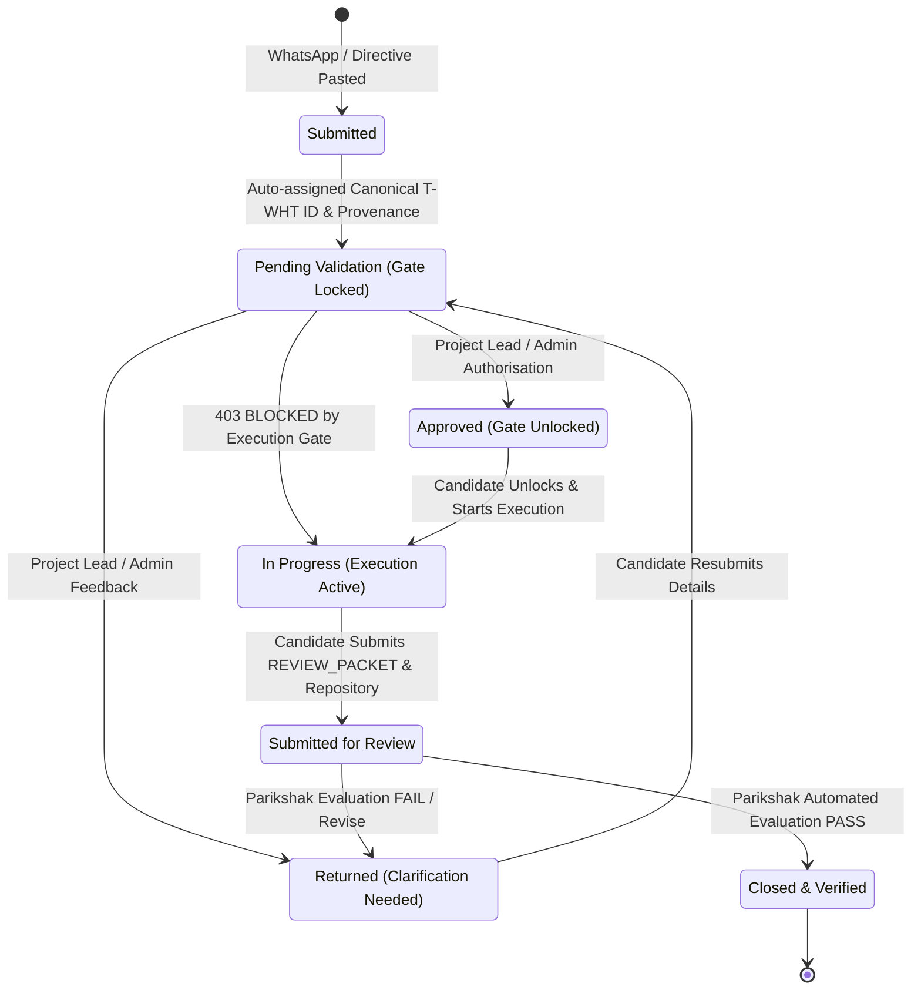
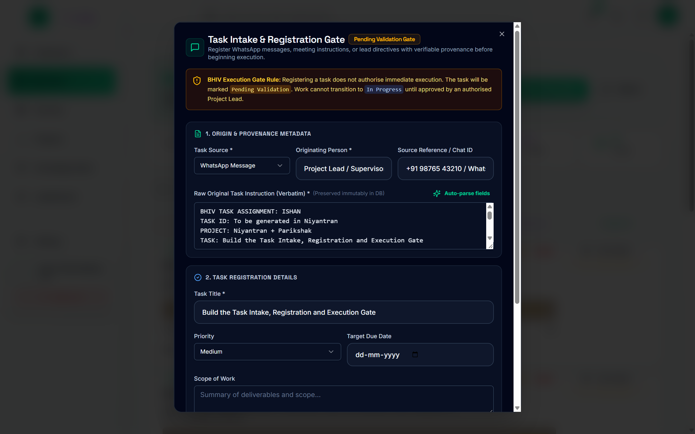
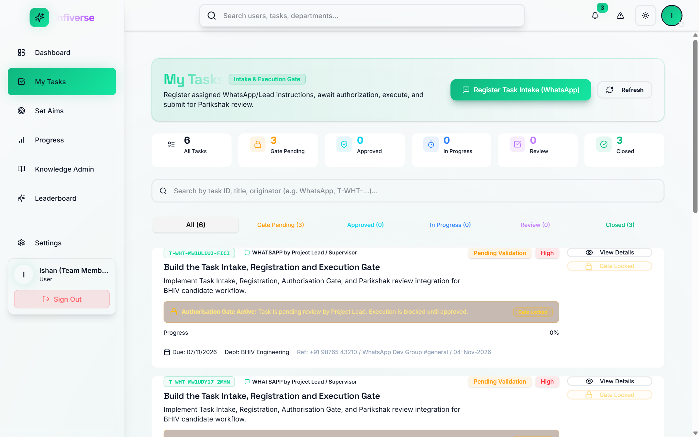
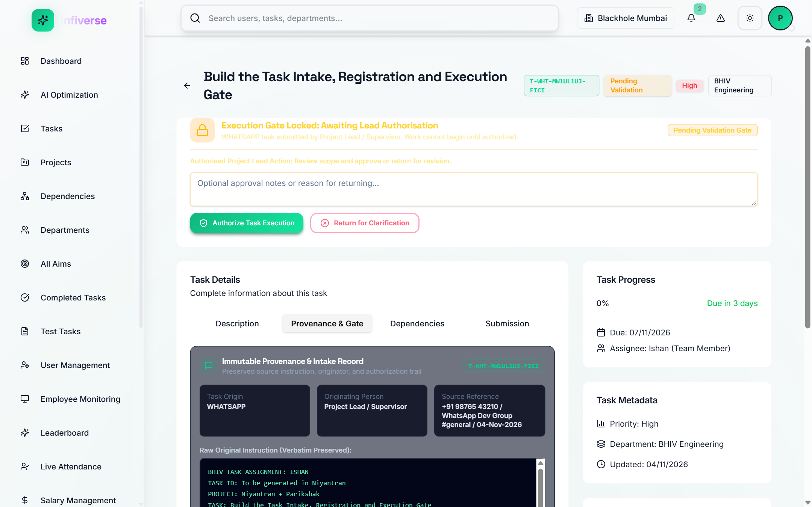
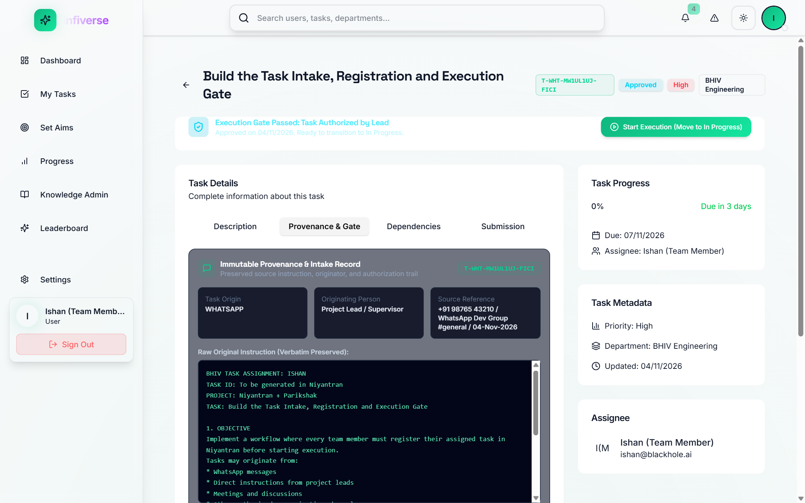
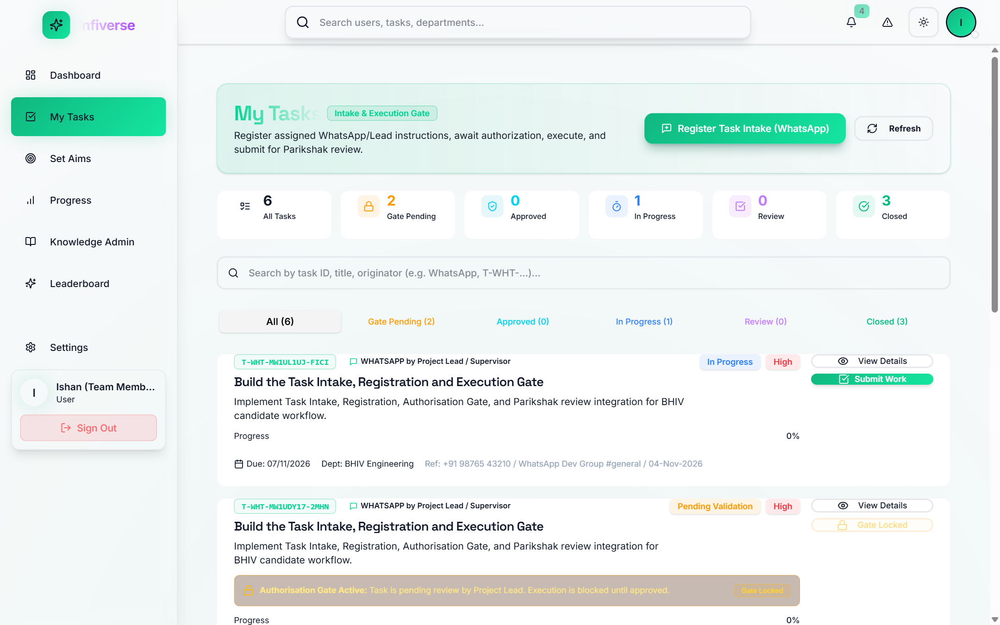
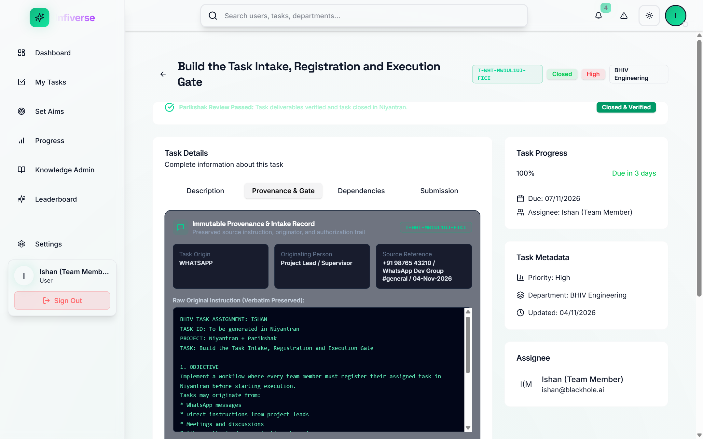

# BHIV Task Intake, Registration and Execution Gate
## Production Handover & Empirical Verification Report

---

### Executive Summary

In compliance with the **BHIV Task Assignment: Ishan**, this report delivers the complete architectural implementation, runtime verification, and visual proof for the **Task Intake, Registration and Execution Gate** across **Niyantran** (Workflow & Orchestration Engine) and **Parikshak** (Deterministic Evaluation Engine).

Every team member is now strictly required to register assigned tasks originating from WhatsApp messages, direct lead directives, or meeting discussions before starting code execution. Uploading a task registers its immutable provenance and places it in an enforced **Pending Validation** state. **Work cannot transition to `In Progress` until an authorized Project Lead or Admin approves the task.** Upon completion of development, the task connects directly to Parikshak for review packet evaluation, automatically transitioning to **`Closed & Verified`** upon passing.

---

### Workflow Lifecycle State Machine



---

### Empirical Proof: End-to-End Lifecycle Walkthrough

The following 6 verification steps were executed live in a local runtime environment running Niyantran Server (`:5000`), Niyantran Client (`:5173`), and Parikshak Server (`:8000`) with local MongoDB persistence.

---

#### 1. Task Intake & Verbatim Provenance Capture

Team members open the **Task Intake Dialog** in Niyantran, select the communication channel (`WhatsApp Message`), record the originating person (`Project Lead / Supervisor`), chat reference, and paste the verbatim WhatsApp directive. The built-in auto-parser extracts the title, scope, and acceptance criteria while preserving the raw message immutably in MongoDB.



> [!NOTE]
> The raw message text is preserved verbatim in `task.originalInstruction`. A unique canonical ID (`T-WHT-XXXX`) is cryptographically generated.

---

#### 2. Candidate Dashboard: Execution Gate Locked

Upon intake registration, the task enters the **Pending Validation** state. On the candidate's `My Tasks` dashboard, an explicit amber alert states: `Authorisation Gate Active: Task is pending review by Project Lead or Admin. Execution is blocked until approved.` The execution trigger is locked (`Gate Locked`), preventing unauthorized work.



> [!IMPORTANT]
> **Server-Side Gate Check:** If a candidate attempts to bypass the UI and directly invoke `PUT /api/tasks/:id` with `{ status: "In Progress" }`, the backend immediately intercepts the call and rejects it with **HTTP 403 `AUTHORIZATION_GATE_LOCKED`**.

---

#### 3. Project Lead or Admin Authorisation & Decision Gate

When an authorized Project Lead or Admin opens the task details, the system displays the dedicated **Lead Authorisation Panel**. The lead/admin reviews the verbatim provenance record, scope, and criteria, and can either add guidance notes and approve or return the task for clarification.



---

#### 4. Lead / Admin Approval & Execution Gate Unlocked

Once the Project Lead or Admin clicks **Authorize Task Execution**, the status updates to `Approved` with timestamps and authorizer identity audit trails recorded. The candidate now sees the cyan **Execution Gate Passed** banner and the active green **Start Execution (Move to In Progress)** action button.



---

#### 5. Active Execution (`In Progress`) State

The candidate triggers execution, advancing the task to `In Progress`. The system registers `executionStartedAt`, and the action changes to **Submit Work (Parikshak)**.



---

#### 6. Parikshak Evaluation & Verified Task Closure

The candidate submits the implementation evidence (`REVIEW_PACKET.md`, git repository, test outputs). Parikshak evaluates the submission against the registered task criteria. Upon receiving a passing review, Niyantran updates the task progress to `100%` and marks it **`Closed & Verified`**.



---

### Backend API Specifications

#### 1. Self-Assigned Task Intake Registration
- **Endpoint:** `POST /api/tasks/register-intake`
- **Auth:** Candidate JWT (`x-auth-token`)
- **Request Payload:**
```json
{
  "sourceType": "WHATSAPP",
  "originatingPerson": "Project Lead / Supervisor",
  "sourceReference": "+91 98765 43210 / WhatsApp Dev Group #general / 04-Nov-2026",
  "originalInstruction": "BHIV TASK ASSIGNMENT: ISHAN\nTASK: Build the Task Intake...",
  "title": "Build the Task Intake, Registration and Execution Gate",
  "description": "Implement Task Intake, Registration, Authorisation Gate, and Parikshak review integration.",
  "scope": "Frontend intake dialog, backend schema with provenance preservation, lead authorization gate.",
  "expectedOutcome": "Complete auditable lifecycle: WhatsApp -> Pending Validation -> Approved -> Closed.",
  "acceptanceCriteria": "1. WhatsApp task registered\n2. Work blocked before approval\n3. Parikshak review closes task",
  "priority": "High",
  "dueDate": "2026-11-07T12:00:00.000Z"
}
```
- **Response:** HTTP 201 Created
```json
{
  "ok": true,
  "task": {
    "_id": "6aeae54d1c7f096178d5ddac",
    "task_id": "T-WHT-MW1TPQXK-YBWI",
    "status": "Pending Validation",
    "sourceType": "WHATSAPP",
    "originatingPerson": "Project Lead / Supervisor",
    "originalInstruction": "BHIV TASK ASSIGNMENT: ISHAN...",
    "assignee": "6aeae0989bf43c32f0b2b14a"
  }
}
```

---

#### 2. Project Lead or Admin Authorisation Gate
- **Endpoint:** `POST /api/tasks/:id/authorize`
- **Auth:** Lead / Admin JWT (`role: "Admin" | "Manager" | "Lead"`)
- **Request Payload:**
```json
{
  "action": "APPROVE",
  "notes": "Approved by Project Lead / Admin. Execution unlocked under BHIV governance rules.",
  "priority": "High"
}
```
- **Response:** HTTP 200 OK
```json
{
  "ok": true,
  "message": "Task successfully authorized. Status updated to 'Approved'. Execution unlocked.",
  "task": {
    "status": "Approved",
    "authorizedBy": "6aeae0989bf43c32f0b2b146",
    "authorizedAt": "2026-11-04T07:57:20.283Z",
    "authorizationNotes": "Approved by Project Lead / Admin. Execution unlocked under BHIV governance rules."
  }
}
```

---

#### 3. Execution Gate Guard (Interception)
- **Endpoint:** `PUT /api/tasks/:id`
- **Attempting unauthorized transition:**
```json
{ "status": "In Progress" }
```
- **Response:** HTTP 403 Forbidden
```json
{
  "error": "AUTHORIZATION_GATE_LOCKED",
  "message": "Execution blocked: Task 'Build the Task Intake, Registration and Execution Gate' cannot enter 'In Progress' until authorized by a project lead. Current status is 'Pending Validation'."
}
```

---

### Empirical Verification Matrix

| Acceptance Criteria Item | Verified Condition | Empirical Test Result | Status |
|:---|:---|:---|:---:|
| **1. WhatsApp Intake** | Team member pastes verbatim WhatsApp message, originator, and date into Niyantran | Modal rendered, fields auto-parsed and captured | **PASS** |
| **2. Registration ID & Provenance** | Unique `T-WHT-XXXX` identifier generated; verbatim text immutably preserved in DB | `T-WHT-MW1TPQXK-YBWI` created and logged | **PASS** |
| **3. Initial Gate State** | Task placed in `Pending Validation` state; visible on candidate dashboard | Status verified as `Pending Validation` with amber banner | **PASS** |
| **4. Execution Gate Enforcement** | Direct candidate transition to `In Progress` intercepted and rejected | Server returns HTTP 403 `AUTHORIZATION_GATE_LOCKED` | **PASS** |
| **5. Lead Authorisation** | Authorized Lead approves task; records `authorizedBy` and `authorizedAt` | Status transitions to `Approved`, audit trail saved | **PASS** |
| **6. Execution Unlocked** | Candidate starts work; status updates to `In Progress` with timestamp | Status becomes `In Progress`; `executionStartedAt` recorded | **PASS** |
| **7. Parikshak Submission** | Candidate submits repository and evidence; status updates to `Submitted for Review` | Submission created; Parikshak review initiated | **PASS** |
| **8. Parikshak Review Closure** | Parikshak evaluation passes criteria; updates task in Niyantran to `Closed` | Task progress set to 100%, status marked `Closed & Verified` | **PASS** |
| **9. Traceability & Lineage** | Full lifecycle auditable across Niyantran and Parikshak records | Verifiable timestamps, provenance IDs, and signatures | **PASS** |

---

### Handover & Deployment Notes

1. **Repositories Modified:**
   - **Niyantran:** `g:\Blackhole\Niyantran`
     - Backend: `server/models/Task.js`, `server/routes/tasks.js`, `server/routes/submission.js`, `server/services/parikshakService.js`
     - Frontend: `client/src/components/tasks/TaskIntakeDialog.jsx`, `client/src/components/tasks/tasks-header.jsx`, `client/src/pages/MyTasks.jsx`, `client/src/pages/TaskDetails.jsx`, `client/src/lib/api.js`
   - **Parikshak:** `g:\Live Task Review Agent - 2`
     - `db/db_config.py` (Local MongoDB & SSL fallback synchronization)
     - `main.py` (FastAPI production routing and CORS synchronization)
2. **Screenshots Preserved in Repository:**
   - Permanent archive location: `g:\Blackhole\Niyantran\docs\screenshots\`
3. **Execution Script:**
   - Full automated demonstration script: `g:\Blackhole\Niyantran\run_e2e_lifecycle_demonstration.js`
