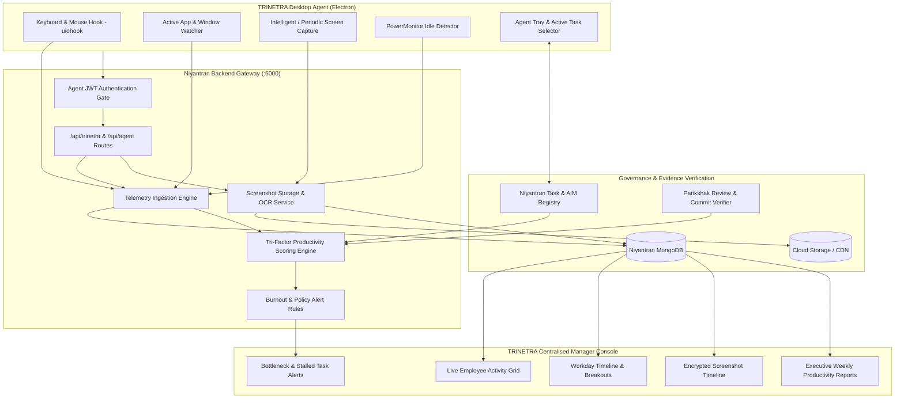

# Implementation Plan: TRINETRA AI AGENT (त्रिनेत्र AI)
## Employee Activity, Task Intelligence & Complete Visibility System

---

## Goal Description

The objective is to establish **TRINETRA AI (त्रिनेत्र AI)** — an enterprise employee activity, productivity, and task verification agent inspired by the three-eyed vision of Lord Shiva, symbolising complete awareness and operational visibility across:
1. **Activity Vision (Eye 1):** Keyboard, mouse, application, website, and idle-time analytics.
2. **Visual Evidence Vision (Eye 2):** Configurable, intelligent screenshot capture and optical verification with privacy controls.
3. **Execution & Deliverable Vision (Eye 3):** Real-time task progress, daily AIM alignment, and deterministic completion verification through GitHub commits, PRs, and Parikshak review packets.

This implementation enhances the existing Niyantran Employee Monitoring System (EMS) and desktop `employee-agent` into a unified, hardened, production-grade intelligence suite without disrupting core attendance, payroll, or task governance workflows.

---

## Architectural State Diagram



---

## User Review Required

> [!IMPORTANT]
> **Strict Non-Interference Boundary:** Core workflow modules (`tasks.js`, `attendance.js`, `salaryManagement.js`, `submission.js`) will **NOT** be refactored or broken. TRINETRA runs as an additive, decoupled layer via `routes/trinetra.js` and dedicated services.

> [!WARNING]
> **Screenshot Privacy & Storage Policy:** 
> - Periodic screenshots generate substantial image data (e.g., 1 capture every 5–10 mins per employee = 50–100 images/day/user).
> - We propose a dual-mode engine:
>   1. **Intelligent Mode (Recommended):** High-frequency capture on policy violations (unapproved apps, social media, prolonged idle) + low-frequency periodic baseline (every 15 mins with image diffing/deduplication).
>   2. **Strict Periodic Mode:** Fixed 5 or 10-minute intervals during active work hours.
>   *Which mode does leadership prefer for the initial rollout?*

> [!NOTE]
> **Agent Network Configuration:** 
> - The Electron agent config currently defaults `AGENT_API_BASE_URL` to `http://localhost:5001/api` in `.env.example`, while Niyantran server runs on `port 5000`. We will standardize this to port `5000` (or `https://niyantran.blackholeinfiverse.com/api` in production).

---

## Open Questions

1. **Screenshot Blur / Privacy Masks:** Should passwords, banking tabs, or sensitive personal data windows automatically be blurred using client-side bounding box masking, or does the team rely on window title whitelisting/blacklisting?
2. **Manager Dashboard Placement:** Should TRINETRA be integrated as the primary view in [`EmployeeMonitoring.jsx`](file:///g:/Blackhole/Niyantran/client/src/pages/EmployeeMonitoring.jsx), or exposed via a dedicated `/trinetra` command center route with a navigation shortcut?
3. **Task Linkage:** When an employee works, should the desktop agent require them to select their current Niyantran Task / AIM from a dropdown so that keyboard/mouse metrics are attributed directly to that specific task?

---

## Capability Breakdown (8 Core Pillars)

| # | Capability | Current Implementation Status | Planned TRINETRA Enhancement |
|:---|:---|:---|:---|
| **1** | **Automatic Screenshot Monitoring** | Violation-only captures implemented; regular periodic captures disabled in `server/services/screenCapture.js` | Add configurable periodic capture in `employee-agent` with perceptual hashing (skip duplicate screens) and upload queue |
| **2** | **Keyboard & Mouse Analytics** | `uIOhook` captures raw key/mouse counts every 30s | Add cadence analytics (intensity, typing burst velocity, engagement index) without recording raw keystrokes (privacy-safe) |
| **3** | **Website & Application Tracking** | Window titles polled via PowerShell `getActiveApp.ps1` | Categorize apps automatically (`Productive`, `Communication`, `Unproductive`) and calculate time allocation percentages |
| **4** | **Idle-Time Monitoring** | `powerMonitor.getSystemIdleTime()` checks system idle | Cluster active vs idle intervals into visual timelines, micro-breaks, and inactivity warning alerts |
| **5** | **Daily AIM & Task Tracking** | Aims and Tasks tracked in separate Niyantran pages | Expose active employee tasks & today's aims inside the desktop agent tray for real-time task selection & time logging |
| **6** | **Completion Verification** | Parikshak evaluates PRs/reviews independently | Cross-correlate active work session telemetry with git commit timestamps, PR links, and Parikshak review verdicts |
| **7** | **Automated Alerts** | Alerts exist for blacklist site visits | Add alerts for stalled tasks, low engagement velocity on critical tasks, and prolonged unaccounted idle time |
| **8** | **Centralised Manager Dashboard** | Tabbed monitoring page exists in `EmployeeMonitoring.jsx` | Unify into a single "TRINETRA Command Console" with Tri-Factor Productivity Scores (0–100), daily/weekly reports, and live status |

---

## Proposed Changes

### Component 1: Desktop Agent (`employee-agent/`)

#### [MODIFY] [`employee-agent/src/managers/activityTracker.js`](file:///g:/Blackhole/Niyantran/employee-agent/src/managers/activityTracker.js)
- Enhance metrics payload:
  - Add active task ID (`activeTaskId`), app category (`Development`, `Meeting`, `Browsing`), and keystroke velocity.
  - Calculate engagement density score per 30-second window.

#### [NEW] `employee-agent/src/managers/screenshotEngine.js`
- Implement desktop screenshot capture inside the Electron process:
  - Uses `desktopCapturer` / `screenshot-desktop` on Windows/Mac/Linux.
  - Generates MD5 / perceptual hash to compare against previous screenshot — skips upload if screen is unchanged.
  - Compresses image to WebP/JPEG (`< 150 KB`) before sending to backend.
  - Supports schedule intervals (e.g. random 5–10 min window).

#### [MODIFY] [`employee-agent/src/services/apiService.js`](file:///g:/Blackhole/Niyantran/employee-agent/src/services/apiService.js)
- Align base URL to port `5000`.
- Add endpoints:
  - `fetchMyActiveTasks()`: Loads assigned Niyantran tasks (`In Progress`) and daily aims.
  - `uploadScreenCapture(buffer, metadata)`: Uploads periodic screenshot to TRINETRA ingest.
  - `verifyAgentSession()`: Heartbeat verifying employee authentication and workday status.

#### [MODIFY] [`employee-agent/src/renderer/index.html`](file:///g:/Blackhole/Niyantran/employee-agent/src/renderer/index.html) & [`app.js`](file:///g:/Blackhole/Niyantran/employee-agent/src/renderer/app.js)
- Add "Active Task" selector dropdown in agent window.
- Display live engagement gauge, current task timer, and synchronization status.

---

### Component 2: Niyantran Backend Gateway (`server/`)

#### [NEW] `server/routes/trinetra.js`
- Dedicated additive router mounted at `/api/trinetra`:
  - `GET /api/trinetra/telemetry/live`: Real-time status grid for all employees (online/idle/active app/active task).
  - `GET /api/trinetra/productivity/summary`: Aggregates daily/weekly hours, active vs idle ratio, and task deliverables.
  - `POST /api/trinetra/agent/screenshot`: Secure endpoint for desktop agent screenshot uploads with sharp compression.
  - `GET /api/trinetra/verification/matrix`: Correlates employee active hours with git commits and Parikshak review scores.
  - `GET /api/trinetra/alerts`: Unified alert stream (policy violations, deadline risks, inactive workday).

#### [MODIFY] [`server/models/EmployeeActivity.js`](file:///g:/Blackhole/Niyantran/server/models/EmployeeActivity.js)
- Add fields for:
  - `taskId`: Associated Niyantran task ID.
  - `appCategory`: `['Development', 'Communication', 'Documentation', 'Unproductive', 'System']`.
  - `keystrokeCadence`: Average keystrokes/minute across the interval.
  - `productivityScore`: Real-time calculated score (0–100).

#### [NEW] `server/services/trinetraProductivityEngine.js`
- Computes **Tri-Factor Productivity Index**:
  $$\text{Score} = (0.4 \times \text{Focus Ratio}) + (0.3 \times \text{Activity Intensity}) + (0.3 \times \text{Deliverable Completion Rate})$$
  - **Focus Ratio:** Percentage of time spent in whitelisted development/work applications vs idle/distracting apps.
  - **Activity Intensity:** Normalized keyboard & mouse interaction frequency within healthy ergonomics.
  - **Deliverable Rate:** On-time task completion and passing Parikshak evaluation verdicts.

#### [MODIFY] [`server/index.js`](file:///g:/Blackhole/Niyantran/server/index.js)
- Mount `app.use('/api/trinetra', require('./routes/trinetra'));` without altering any existing route handlers.

---

### Component 3: Frontend Centralised Manager Dashboard (`client/`)

#### [MODIFY] [`client/src/pages/EmployeeMonitoring.jsx`](file:///g:/Blackhole/Niyantran/client/src/pages/EmployeeMonitoring.jsx)
- Brand and upgrade to **TRINETRA AI Command Center**:
  - **Eye 1 (Live Activity):** Real-time employee cards with live app badge, active task title, keyboard/mouse pulse indicator, and idle meter.
  - **Eye 2 (Visual Timeline):** Screenshot gallery with time scrub bar, policy violation highlights, and OCR text search.
  - **Eye 3 (Deliverables & Parikshak):** Task delivery verification panel showing GitHub PR links, commit hashes, and Parikshak evaluation scores alongside recorded work hours.
  - **Export Center:** Download Daily & Weekly Executive Productivity Reports (PDF & Excel formats).

#### [MODIFY] [`client/src/lib/api.js`](file:///g:/Blackhole/Niyantran/client/src/lib/api.js)
- Add `trinetraAPI` object wrapping all `/api/trinetra/*` endpoints with auth header propagation.

---

## Verification Plan

### Phase 1: Local Backend & Agent Telemetry
```powershell
# 1. Verify Niyantran server starts with TRINETRA router
cd "g:\Blackhole\Niyantran\server"
node -e "require('./routes/trinetra'); console.log('✅ TRINETRA router syntax valid');"

# 2. Run agent build test
cd "g:\Blackhole\Niyantran\employee-agent"
npm test
```

### Phase 2: End-to-End Simulation Script
- Create `test_trinetra_lifecycle.js`:
  1. Authenticates test employee (`ishan@blackhole.ai`).
  2. Starts active workday session.
  3. Transmits telemetry packets (keyboard, mouse, active app `VS Code`, task `T-WHT-XXXX`).
  4. Uploads test screenshot to `/api/trinetra/agent/screenshot`.
  5. Computes productivity score via `/api/trinetra/productivity/summary`.
  6. Verifies manager dashboard receives live telemetry and visual timeline.

### Phase 3: Manual Verification
1. Launch Electron Agent (`npm start` in `employee-agent`).
2. Log in as employee and start day.
3. Switch between VS Code, Chrome, and idle state — confirm real-time updates in Niyantran Web UI `/monitoring`.
4. Check that screenshot is captured and deduplicated if screen does not change.
5. Verify manager dashboard shows accurate Tri-Factor productivity score and task verification link.
