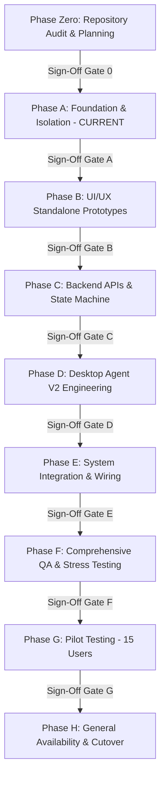

# Niyantran Employee Monitoring V2: Master Engineering Directive & Implementation Plan

**Document ID:** `V2-DOC-00`  
**Classification:** Master Engineering Architecture & Governance Plan  
**Target Project:** `Niyantran` (Infiverse Ecosystem)  
**Date:** November 2026  
**Status:** DRAFT / UPDATED FOR PHASE A CORRECTIONS  
**Current Phase:** Phase A (Architecture Corrections, Foundation & Strict Isolation)  

---

## 1. Executive Directive & Mission Statement

### Mission
Build an entirely new, independent, production-grade **Employee Monitoring V2** platform inside the existing Niyantran repository. The new system must provide reliable, privacy-first, OS-level activity tracking for remote and hybrid employees—especially those on personally owned (BYOD) devices—without requiring the Niyantran browser tab to remain open, while keeping legacy Employee Monitoring V1 and all other Niyantran business systems fully operational.

### The 13 Core Mandates (Updated for Phase A Safety)
1. **Architectural Independence:** V2 is completely decoupled from V1 monitoring code, models, and UI.
2. **Zero V1 Disruption & Non-Interference:** V2 must never terminate, pause, disable, uninstall, or alter V1 automatically. Legacy V1, Attendance, Tasks, Aims, and Parikshak remain 100% operational.
3. **Separate Admin Console:** Elegant, minimalist, uncluttered SaaS monitoring interface for administrators.
4. **Separate Employee Workspace:** Clean, self-service dashboard with zero access to peer or team surveillance.
5. **Independent Desktop Agent:** Background agent operating independently of browser lifecycle without invasive hooks.
6. **Background OS-Level Activity:** Accurate tracking when working in VS Code, terminal, CAD, or other apps.
7. **3-Mode Device Architecture:** Clear separation of **Phone Mode**, **Laptop/PC Mode**, and **Switch Device Mode**.
8. **Privacy-by-Design BYOD Protection:** Zero raw keystrokes, zero screenshots, zero clipboard/URL tracking. Claims of statutory compliance must be accompanied by qualified legal review.
9. **Zero Attendance Side Effects:** Monitoring V2 does not automatically clock-in, clock-out, modify attendance, or calculate salary deductions. Attendance integration is strictly an unmounted read-only check.
10. **Decoupled Data Tier:** Independent `/api/monitoring-v2/*` routes, session tokens, and MongoDB collections (`monitoring_v2_*`).
11. **Feature Flag Gating:** V2 remains disabled by default across all tiers until explicitly approved.
12. **Complete 4-Tier Rollback:** Rollback encompasses frontend hiding, backend route rejection, session lease revocation, and autonomous agent-side shutdown.
13. **Strict V1 Preservation:** V1 is never deleted, deactivated, or modified without separate explicit authorization.

---

## 2. Teamwork Governance & Ownership Matrix

```
┌────────────────────────────────────────────────────────────────────────────────────────┐
│                        V2 SPECIALIZED ENGINEERING DISCIPLINE MATRIX                    │
├──────────────────────────┬────────────────────────────┬────────────────────────────────┤
│ Team Discipline          │ Primary Lead / Owner       │ Key Deliverables Owned         │
├──────────────────────────┼────────────────────────────┼────────────────────────────────┤
│ 1. Principal Architect   │ Architecture Team          │ Roadmap, Separation, ADRs, Doc │
│ 2. Desktop Engineer      │ Desktop Systems Team       │ Agent V2, uiohook, Tray, Win32 │
│ 3. Backend & DB Engineer │ Backend Core Team          │ APIs, State Machine, MongoDB   │
│ 4. UI/UX Engineer        │ Frontend Engineering Team  │ Admin Console, Employee Space  │
│ 5. Security & Privacy    │ Cybersecurity Specialist   │ BYOD Model, DPDP/GDPR, HMAC    │
│ 6. QA & Reliability      │ Quality Assurance Lead     │ 28-Point Matrix, Benchmarking  │
└──────────────────────────┴────────────────────────────┴────────────────────────────────┘
```

### Team Coordination Rules
- **Architectural Supremacy:** The Principal Architect maintains the master implementation sequence.
- **Shared Findings:** Engineering teams share verified repository facts rather than repeating searches.
- **Strict File Ownership:** No concurrent edits to shared layout or routing files.
- **Quality Gates:** Every implementation phase must receive unconditioned sign-off from all 6 disciplines.
- **Zero Premature Code:** Strictly no runtime code changes or dependency installations during Phase A.

---

## 3. High-Level Master Phase Sequence



---

## 4. Master Implementation Status & Governance Ledger

| Phase | Description | Discipline Lead | Status | Test Coverage | Blockers | Authorization Gate |
| :---: | :--- | :--- | :---: | :---: | :---: | :---: |
| **Phase 0** | Repo Audit & Planning Documentation | Principal Architect | **COMPLETE** | Verified Static Code | None | Approved |
| **Phase A** | Independent Foundation & Isolation | Architect / Backend | **IN PROGRESS**| Isolation Unit Tests | None | **CURRENT AUTHORIZATION** |
| **Phase B** | Standalone Admin & Employee UI | Frontend Engineer | DORMANT | Component / Visual | Requires Phase A | Gate B (Pending) |
| **Phase C** | Backend APIs & MongoDB Collections | Backend Engineer | DORMANT | Integration / API | Requires Phase B | Gate C (Pending) |
| **Phase D** | Desktop Agent V2 & Native Hooks | Desktop Engineer | DORMANT | Native / OS Mock | Requires Phase C | Gate D (Pending) |
| **Phase E** | End-to-End System Integration | All Disciplines | DORMANT | E2E Integration | Requires Phase D | Gate E (Pending) |
| **Phase F** | 28-Point Verification & Stress Test | QA & Reliability | DORMANT | 28 Scenarios | Requires Phase E | Gate F (Pending) |
| **Phase G** | Internal Pilot Rollout (15 Users) | Security / QA | DORMANT | Live Telemetry | Requires Phase F | Gate G (Pending) |
| **Phase H** | Production Cutover & V1 Migration | Principal Architect | DORMANT | Fleet-Wide Audit | Requires Phase G | Gate H (Pending) |

---

## 5. Master Documentation Index (`docs/employee-monitoring-v2/`)

The engineering design for Employee Monitoring V2 is detailed across 17 planning artifacts:

- `00_MASTER_IMPLEMENTATION_PLAN.md` (This Master Plan)
- `01_VERIFIED_REPOSITORY_AUDIT.md` (Static Audit of Existing Codebase)
- `02_V1_V2_ISOLATION_STRATEGY.md` (Decoupling, Mutual Exclusion & Non-Interference)
- `03_SYSTEM_ARCHITECTURE.md` (System Topology, Tier Boundaries & Data Pipelines)
- `04_DESKTOP_TECH_STACK_DECISION.md` (Runtime Benchmark Methodology & ADR)
- `05_DESKTOP_AGENT_SPECIFICATION.md` (Agent Architecture, Lifecycle & Conflict Detection)
- `06_DEVICE_SESSION_GOVERNANCE.md` (3-Mode Device Lifecycle & Session Lease Protocols)
- `07_ADMIN_UI_BLUEPRINT.md` (Premium Admin Console Information Architecture & Layouts)
- `08_EMPLOYEE_UI_BLUEPRINT.md` (Minimal Employee Workspace & Compact Device Switcher)
- `09_ROLE_PERMISSION_MATRIX.md` (RBAC, Scopes & Per-Employee Data Boundaries)
- `10_API_DATABASE_CONTRACTS.md` (Mongoose Schemas, TTLs & REST/WebSocket Contracts)
- `11_BYOD_PRIVACY_SECURITY.md` (Privacy-by-Design Objectives & Legal Disclaimers)
- `12_RELIABILITY_PERFORMANCE_PLAN.md` (Fault Tolerance, Offline Buffering & Performance Budgets)
- `13_IMPLEMENTATION_PHASES.md` (Staged Workstreams, Prerequisites & Acceptance Criteria)
- `14_TESTING_ACCEPTANCE_MATRIX.md` (28-Point Verification Suite & Security Assertions)
- `15_PILOT_MIGRATION_ROLLBACK.md` (Pilot Protocols, Complete Rollback & Safety Gates)
- `16_RISK_AND_DECISION_REGISTER.md` (Active Architectural Decisions & Risk Mitigations)
