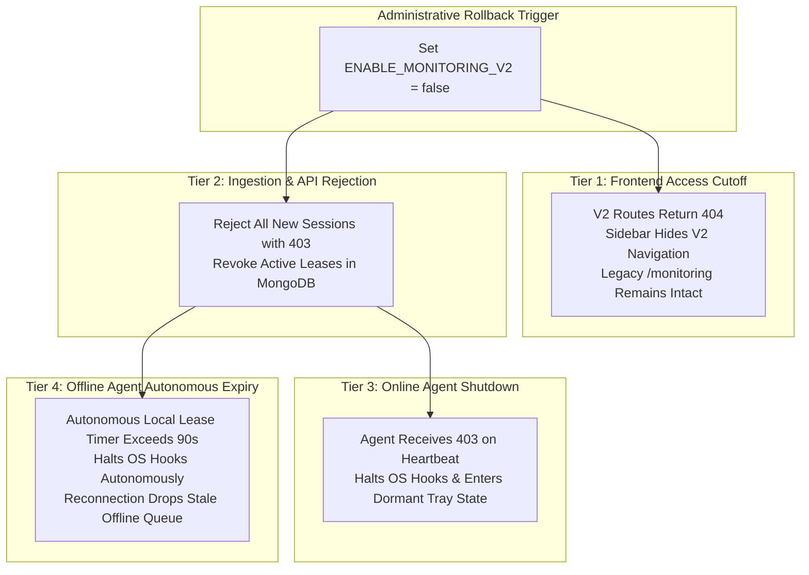

# V1/V2 System Isolation & Coexistence Strategy

**Document ID:** `V2-DOC-02`  
**Classification:** Architectural Boundary & Non-Interference Specification  
**Target Repository:** `Niyantran`  
**Date:** November 2026  
**Status:** UPDATED FOR PHASE A CORRECTIONS  

---

## 1. Executive Isolation Policy

To maintain business continuity, zero-risk operations, and independent testing, **Employee Monitoring V2** is architected to run strictly in parallel with existing systems without any interference.

### The Non-Interference Guarantees:
1. **Zero V1 Modification:** Legacy Employee Monitoring V1 files, routes, components, and desktop agent files remain **100% untouched**.
2. **Zero Automatic Interference with V1 Agent:** V2 must never terminate, pause, disable, uninstall, or alter the legacy V1 agent automatically.
3. **Zero Cross-Imports:** V2 modules must never import monitoring services, helpers, or state from V1.
4. **Database Segregation:** V2 writes exclusively to its own dedicated MongoDB collections (`monitoring_v2_*`). V2 never writes to, modifies, or alters V1 collections (`employee_activities`, `keystroke_logs`, `screen_captures`).
5. **Zero Attendance Side Effects:** Monitoring V2 does not automatically alter attendance, clock in/out, modify hours, or calculate salary deductions. Attendance checks are strictly abstract, disabled read-only adapters.
6. **API Isolation:** All V2 endpoints are strictly namespaced under `/api/monitoring-v2/*`.
7. **UI Independence:** All V2 user interfaces live under `/monitoring-v2/*` and operate under their own independent state providers.
8. **Complete 4-Tier Rollback:** V2 visibility and ingestion are controlled by environment feature flags and active agent-side shutdown hooks.

---

## 2. Directory & Namespace Segregation Matrix

```
┌─────────────────────────────┬─────────────────────────────────┬─────────────────────────────────┐
│ System Layer                │ Legacy V1 Implementation        │ New Independent V2 Architecture │
├─────────────────────────────┼─────────────────────────────────┼─────────────────────────────────┤
│ **Frontend Module**         │ `client/src/pages/`             │ `client/src/modules/`           │
│                             │ `EmployeeMonitoring.jsx`        │ `employee-monitoring-v2/`       │
│ **Frontend Route**          │ `/monitoring`                   │ `/monitoring-v2/*`              │
│ **Backend Code**            │ `server/routes/monitoring.js`   │ `server/modules/`               │
│                             │ `server/routes/agentActivity.js`│ `employee-monitoring-v2/`       │
│ **Backend API Route**       │ `/api/monitoring/*`             │ `/api/monitoring-v2/*`          │
│                             │ `/api/agent/*`                  │                                 │
│ **Desktop Agent**           │ `employee-agent/`               │ `employee-agent-v2/`            │
│ **Database Collections**    │ `employee_activities`           │ `monitoring_v2_devices`         │
│                             │ `keystroke_logs`                │ `monitoring_v2_sessions`        │
│                             │ `screen_captures`               │ `monitoring_v2_telemetry`       │
│                             │ `monitoring_alerts`             │ `monitoring_v2_audit_logs`      │
│ **Session State Model**     │ In-memory Map in `ems_signals`  │ Authoritative Lease Engine      │
│ **Desktop Hook Output**     │ Scan codes mapped to text       │ Aggregated event counts only    │
└─────────────────────────────┴─────────────────────────────────┴─────────────────────────────────┘
```

---

## 3. Desktop Agent Coexistence & Conflict Handling (Correction 1)

**Mandatory Rule:** V2 must never terminate, pause, disable, uninstall, or alter V1 automatically.

During pilot testing and phased migration, employees might have both the legacy V1 agent (`employee-agent`) and the new V2 agent (`employee-agent-v2`) installed on the same computer.

Running two global OS input hooks concurrently on the same machine can cause OS input lag, dropped keystrokes, and conflicting data.

### Safe V1 Conflict Detection Protocol:
```
[Agent V2 Startup] ──> Non-Invasive Process Scan (Process Name: "employee-activity-agent")
                             │
              ┌──────────────┴──────────────┐
              ▼                             ▼
        [V1 DETECTED]               [V1 NOT DETECTED]
              │                             │
    V2 REFUSES TO ACTIVATE          Acquire V2 Local Mutex
    State: V1_AGENT_CONFLICT                │
              │                             ▼
    Display Advisory Banner:        Start Telemetry Collection
 "Legacy Agent V1 is active.                 │
  V2 collector is standing by.               ▼
  Please stop V1 manually if        Stream to /api/monitoring-v2/ingest
  you wish to use V2."
              │
    Preserve V1 Completely!
```

1. **Non-Invasive Detection:** V2 inspects the local OS process table using standard read-only queries (e.g. `tasklist /FI "IMAGENAME eq employee-activity-agent.exe"` on Windows, or `pgrep -f "employee-activity-agent"` on macOS/Linux). It does **not** inject code, send termination signals, or touch V1 files.
2. **Refusal to Activate:** If V1 is running, V2 refuses to start its native input hooks (`uiohook-napi` / event taps). The V2 system tray icon displays an amber conflict badge (`V1_AGENT_CONFLICT`).
3. **Manual Authorized Handoff:** The V2 UI informs the employee: *"Legacy Monitoring Agent V1 is currently active. To prevent duplicate telemetry and input lag, V2 monitoring is standing by. Please close or pause the V1 Agent manually if you wish to run V2."*
4. **V1 Preservation:** If V2 fails or is closed, V1 continues operating with zero disruption.
5. **Administrative Pilot Controls:** In Phase G, pilot enrollment is managed administratively to ensure pilot testers run only V2, minimizing dual-installation friction.

---

## 4. Complete 4-Tier Rollback Mechanism (Correction 4)

A backend feature flag alone is not a complete rollback mechanism. A disconnected desktop agent could continue collecting and buffering telemetry locally. 

V2 implements a verified **4-Tier Rollback Architecture**:



1. **Tier 1 (Frontend):** Setting `ENABLE_MONITORING_V2=false` immediately hides the V2 navigation entry from `DashboardSidebar.jsx` and returns `404 Not Found` on `/monitoring-v2/*`.
2. **Tier 2 (Gateway):** Gateway middleware rejects all new session requests with `403 FORBIDDEN: MONITORING_V2_DISABLED`. Active session leases in `monitoring_v2_sessions` are updated to `REVOKED`.
3. **Tier 3 (Online Agent Shutdown):** Within 10 seconds (the heartbeat interval), running V2 agents receive `{ serverCommand: "TERMINATE_SESSION", reason: "ROLLBACK" }`. The agent calls `uIOhook.stop()`, unbinds native listeners, and transitions to a dormant tray status.
4. **Tier 4 (Offline Agent Autonomous Expiry):** If an agent is offline when rollback occurs:
   - The agent's local lease has an absolute hardware countdown (60s lease + 30s grace = 90 seconds maximum).
   - Once 90 seconds elapse without a successful server renewal, the agent's internal timer **autonomously halts all input hooks**.
   - Offline queue safeguard: If the agent reconnects later, the server rejects the batch (`410 LEASE_EXPIRED_DURING_ROLLBACK`), and the agent purges the stale offline buffer rather than uploading revoked-session telemetry.
5. **Zero V1 Impact:** Throughout the entire rollback, legacy V1 monitoring and attendance continue operating with 0% downtime.
