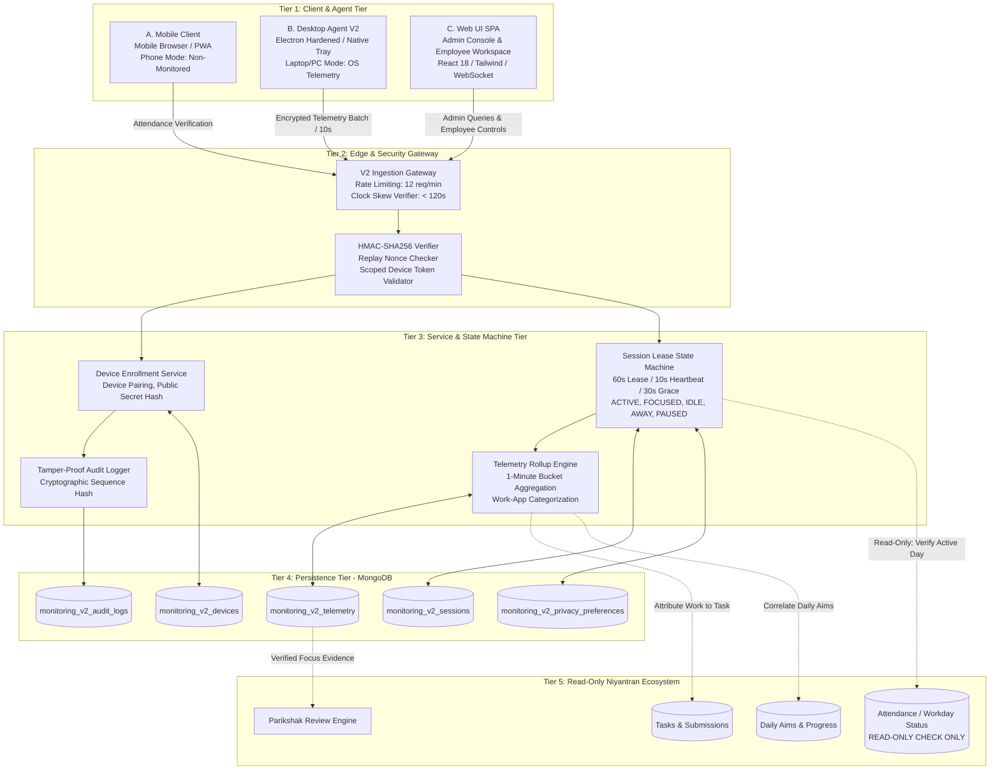
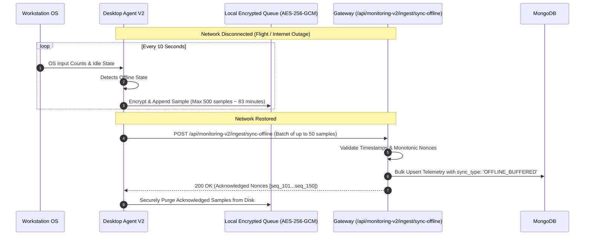

# Employee Monitoring V2: System Architecture & Data Flow Specification

**Document ID:** `V2-DOC-03`  
**Classification:** Complete System Architecture Document (SAD)  
**Target Repository:** `Niyantran`  
**Date:** November 2026  
**Status:** UPDATED FOR PHASE A CORRECTIONS  

---

## 1. Architectural Topology & Tier Boundaries

Employee Monitoring V2 is architectured across five decoupled tiers to ensure scalability, fault isolation, strict privacy enforcement, and complete independence from legacy systems.



---

## 2. Attendance Isolation & Non-Interference (Correction 5)

**Mandatory Rule:** Employee Monitoring V2 has **zero side effects on attendance records**.

Under no circumstances will V2:
- Automatically clock an employee in or out.
- Modify `Attendance` or `DailyAttendance` records.
- Alter `hoursWorked`, `breakTime`, `overtimeHours`, or presence flags.
- Trigger automatic salary, stipend, or productivity penalties.
- Alter existing attendance APIs or database schemas.

### The Read-Only Attendance Adapter (`attendanceAdapter.js`):
V2 defines an isolated read-only adapter interface. It queries attendance strictly to answer one question:
> *"Does this employee currently have an authorized open workday?"*

```javascript
// server/modules/employee-monitoring-v2/services/attendanceAdapter.js
// READ-ONLY ADAPTER - ZERO ATTENDANCE MUTATION
const Attendance = require('../../../models/Attendance');
const DailyAttendance = require('../../../models/DailyAttendance');

async function isWorkdayActive(userId) {
  try {
    const today = new Date();
    today.setHours(0, 0, 0, 0);

    const activeRecord = await Attendance.findOne({
      user: userId,
      date: { $gte: today },
      startDayTime: { $ne: null },
      $or: [{ endDayTime: null }, { endDayTime: { $exists: false } }]
    }).select('_id startDayTime').lean();

    return Boolean(activeRecord);
  } catch (error) {
    console.error('[V2 AttendanceAdapter] Read-only check failed:', error.message);
    return false;
  }
}
```

V2 session start/stop operations represent **monitoring work sessions**, completely decoupled from formal HR attendance.

---

## 3. Core Operational Pipelines

### Pipeline A: Online Real-Time Telemetry Pipeline (10s Cadence)
```mermaid
sequenceDiagram
    autonumber
    participant Host as Workstation OS
    participant Agent as Desktop Agent V2
    participant GW as Gateway (/api/monitoring-v2/ingest)
    participant SM as Session State Machine
    participant DB as MongoDB (monitoring_v2_telemetry)
    participant UI as Admin Live Console (WebSocket)

    Host->>Agent: Keyboard presses & Mouse deltas (Counts Only)
    Host->>Agent: Active Process Name & Idle Seconds
    Agent->>Agent: Discard personal apps; aggregate counters (10s window)
    Agent->>GW: POST /api/monitoring-v2/ingest (Batch + HMAC-SHA256 + Nonce)
    GW->>GW: Verify HMAC signature & monotonic sequence number
    GW->>SM: Verify Active Session Lease
    alt Lease Active & Valid
        GW->>DB: Upsert to 1-Minute Aggregation Bucket
        GW->>SM: Renew Lease Timestamp (lastSeenAt = now)
        GW-->>Agent: 200 OK (serverCommand: CONTINUE, leaseExpiresAt: now + 60s)
        GW->>UI: Emit WebSocket Update (live_telemetry_tick)
    else Lease Transferred or Expired
        GW-->>Agent: 409 CONFLICT (Session transferred to Device B)
        Agent->>Agent: Halt monitoring & display tray alert
    end
```

### Pipeline B: Offline Encrypted Buffering & Synchronization


### Pipeline C: Device Handoff Protocol (Mutual Exclusion)
```mermaid
sequenceDiagram
    autonumber
    actor Employee
    participant DevA as Origin Device A (PC)
    participant DevB as Destination Device B (Mac/Phone)
    participant Backend as Backend Session Router
    participant DB as MongoDB (monitoring_v2_sessions)

    Employee->>DevB: Initiates "Switch Device" in Employee Workspace
    DevB->>Backend: POST /api/monitoring-v2/sessions/switch (targetDeviceId, PIN)
    Backend->>Backend: Verify DevB Registration & Authorization
    Backend->>DB: Atomically Revoke DevA Lease; Grant DevB Lease
    Backend->>DB: Append Handoff Record to Session History
    Backend-->>DevB: 200 OK (Session Transferred; Start Tracking)
    
    DevA->>Backend: Regular 10s Heartbeat (POST /sessions/heartbeat)
    Backend-->>DevA: 409 CONFLICT (LEASE_REVOKED: Transferred to DevB)
    DevA->>DevA: Halt local input hooks; update tray status to "Transferred"
```
