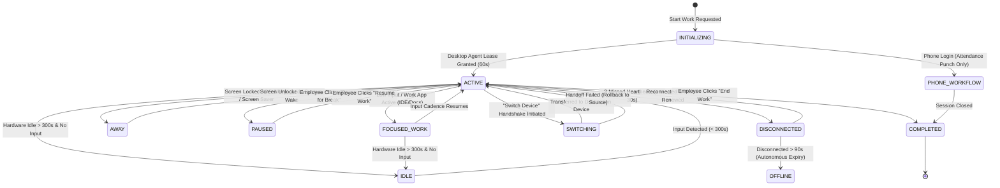

# Device Management & Work-Session Governance: 3-Mode Protocol

**Document ID:** `V2-DOC-06`  
**Classification:** Device Architecture & Protocol Specification  
**Target Subsystem:** `server/modules/employee-monitoring-v2/services/sessionManager.js`  
**Date:** November 2026  
**Status:** UPDATED FOR PHASE A CORRECTIONS  

---

## 1. The 3-Mode Device Architecture

In modern hybrid engineering teams, employees frequently transition between smartphones and laptops. Niyantran V2 establishes an explicit, server-authoritative **Three-Mode Device Governance Model**:

```
               ┌─────────────────────────────────────────────────────────┐
               │           NIYANTRAN 3-MODE DEVICE GOVERNANCE            │
               └────────────────────────────┬────────────────────────────┘
                                            │
        ┌───────────────────────────────────┼───────────────────────────────────┐
        ▼                                   ▼                                   ▼
 ┌───────────────┐                  ┌───────────────┐                  ┌─────────────────┐
 │   A. PHONE    │                  │ B. LAPTOP/PC  │                  │C. SWITCH DEVICE │
 └───────┬───────┘                  └───────┬───────┘                  └────────┬────────┘
         │                                  │                                   │
 • Mobile Attendance (GPS/Biometric)• Verified Registered Desktop Agent• Cryptographic Session Transfer
 • Mobile Workflows (Review/Chat)   • OS-Level Activity Ingestion      • Lease Migration Handshake
 • Non-Monitored (Zero Idle Penalty)• Visible Tray & Pause Controls    • Mutual Exclusion Enforcement
 • ZERO Attendance Alteration       • Active/Focused Work Accounting   • Atomic Rollback on Failure
```

---

## 2. Mode Detailed Rules & Behaviors

### Mode A: Phone (Mobile Workflows & Field Presence)
- **Primary Targets:** iOS Safari, Android Chrome (PWA or Mobile Web).
- **Authorized Workflows:**
  - Standard Niyantran mobile web tasks (reviewing tasks, updating comments, viewing aims).
  - Procurement approvals, internal notifications, and personal profile management.
- **Monitoring Policy (Strict Non-Surveillance):**
  - Mobile browsers will **NEVER** run background keydown or mouse tracking scripts.
  - Active time on mobile is explicitly flagged in backend logs as `MODE: PHONE_WORKFLOW`.
  - **Zero Idle Penalty:** An employee logged into mobile is **NEVER** classified as "idle desktop time" and never assigned 0% productivity.
  - Using a mobile device must **never** invalidate an active work session.
  - **Zero Attendance Side Effects:** V2 Phone Mode does not automatically clock employees in or out or alter attendance records.

### Mode B: Laptop / PC (Verified Monitored Workstation)
- **Primary Targets:** Windows 10/11, macOS, Linux (Workstations & BYOD Laptops).
- **Core Governance:**
  - Requires a one-time device enrollment via the V2 web portal, generating an immutable `deviceId` and hashed `deviceToken`.
  - The employee starts an explicit monitored work session (`POST /api/monitoring-v2/sessions/start`).
  - The desktop agent acquires a server-authoritative **Session Lease** (60s duration, renewed every 10s via telemetry heartbeat).
  - Collects aggregated input counts and active application category completely independent of whether the Niyantran browser tab is open, minimized, or closed.

### Mode C: Switch Device (Zero-Downtime Session Handoff)
- **Objective:** Enable an employee working on Laptop A to transition seamlessly to Laptop B (or Phone) without resetting attendance, losing session continuity, or creating conflicting duplicate streams.
- **Mutual Exclusion Guarantee:** At any given millisecond, a user can have **only one** active monitored device lease.
- **The Handoff Handshake:**
  1. Employee clicks "Switch Device" on Destination Device (Device B).
  2. Device B prompts for authentication (or scans a one-time pairing QR code displayed on Device A).
  3. Server validates Device B and issues a conditional handoff lease.
  4. Server revokes the lease for Device A. On Device A's next 10-second heartbeat, it receives `409 LEASE_REVOKED` and cleanly stops local monitoring.
  5. Server binds the active session ID to Device B. Zero attendance time is lost.
  6. **Atomic Rollback:** If Device B fails to establish its heartbeat within 60 seconds, the transfer is aborted and Device A is permitted to resume its lease.

---

## 3. Authoritative Session Lease State Machine



---

## 4. Heartbeat Parameters & Collision Denial

| Parameter | Value | Operational Purpose |
| :--- | :--- | :--- |
| **Telemetry Cadence** | 10 seconds | Interval at which agent sends aggregated counters to `/api/monitoring-v2/ingest`. |
| **Lease Duration** | 60 seconds | Lifetime of server-granted lease. If no heartbeat arrives within 60s, lease expires. |
| **Grace Window** | 30 seconds | Period during which a reconnecting agent can re-acquire lease before state transitions to `DISCONNECTED`. |
| **Autonomous Expiry** | 90 seconds | Period after which a disconnected agent halts hooks autonomously without server renewal. |
| **Max Pause Duration** | 60 minutes | Maximum daily break time permitted before manager notification is triggered. |

### Duplicate Session Collision Prevention:
If Device B attempts to start a monitored work session while Device A holds a valid lease:
1. The server immediately rejects Device B with `409 CONFLICT: ACTIVE_SESSION_ON_OTHER_DEVICE`.
2. Device B's UI displays: *"Session already active on [Device A Name]. Would you like to initiate a Device Switch?"*
3. Device A's lease is undisturbed.
4. A security audit log is recorded in `monitoring_v2_audit_logs`.
