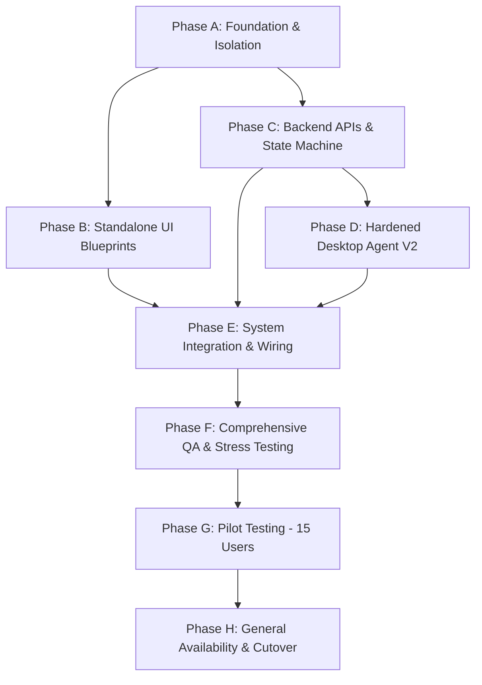

# Staged Implementation Phases & Workstream Deliverables

**Document ID:** `V2-DOC-13`  
**Classification:** Engineering Roadmap & Milestones  
**Target Repository:** `Niyantran`  
**Date:** November 2026  
**Status:** DRAFT / PENDING APPROVAL  

---

## 1. Phase Dependency Graph & Execution Order

---

## 2. Phase-by-Phase Detailed Specifications

### Phase A: Foundation & Isolation
- **Discipline Leads:** Principal Architect & Backend Lead.
- **Prerequisites:** Formal supervisory approval of Phase Zero audit & planning package.
- **Key Deliverables:**
  - Create directory trees: `client/src/modules/employee-monitoring-v2/`, `server/modules/employee-monitoring-v2/`, `employee-agent-v2/`.
  - Implement environment feature flag: `ENABLE_MONITORING_V2 = false` by default.
  - Define TypeScript / JSDoc shared data contract interfaces.
- **Acceptance Criteria:**
  - V2 directories created without touching a single V1 file.
  - Existing Niyantran tests and application boot sequence run with zero warnings.

---

### Phase B: Standalone UI Prototypes (Mock Data)
- **Discipline Lead:** UI/UX & Frontend Engineer.
- **Prerequisites:** Phase A sign-off.
- **Key Deliverables:**
  - Build `EmployeeWorkspaceView.jsx` with compact device switcher (Phone / Laptop / Switch).
  - Build `AdminFleetView.jsx` with clean executive dashboard and live presence grid.
  - Implement `TodayActivityTimeline.jsx` with 1-minute bucket SVG rendering.
  - Wire mock state providers (`MonitoringV2Context.jsx`).
- **Acceptance Criteria:**
  - New route `/monitoring-v2` navigates cleanly to new views.
  - Old route `/monitoring` continues rendering legacy V1 without visual regressions.

---

### Phase C: Backend APIs & State Machine
- **Discipline Lead:** Backend & Database Engineer.
- **Prerequisites:** Phase A sign-off.
- **Key Deliverables:**
  - Deploy Mongoose models: `RegisteredDevice.js`, `MonitoringSessionV2.js`, `AggregatedTelemetryV2.js`, `DeviceAuditLog.js`.
  - Implement REST routes: `/api/monitoring-v2/devices/*`, `/sessions/*`, `/ingest/*`.
  - Implement server-authoritative lease state machine (60s lease, 10s heartbeat, 30s grace).
  - Implement HMAC-SHA256 signature verifier and monotonic nonce deduplicator.
- **Acceptance Criteria:**
  - Integration test suite passes 100% of route assertions.
  - Tampered signatures or clock skew > 120s are rejected with `401 Unauthorized`.

---

### Phase D: Hardened Desktop Agent V2
- **Discipline Lead:** Desktop Systems Engineer.
- **Prerequisites:** Phase C API contracts defined.
- **Key Deliverables:**
  - Scaffold `employee-agent-v2/` with Electron 31 LTS.
  - Implement `uiohook-napi` input counter (discarding all keycodes immediately).
  - Implement native C++ Win32 and Cocoa foreground window query addons.
  - Implement Electron `safeStorage` for device secrets.
  - Implement AES-256-GCM local encrypted ring buffer for offline queuing.
  - Build system tray menu with 1-click pause/resume controls.
- **Acceptance Criteria:**
  - Agent memory footprint < 120MB; CPU utilization < 0.4%.
  - Zero background PowerShell processes spawned.

---

### Phase E: System Integration & Wiring
- **Discipline Leads:** All 6 Disciplines.
- **Prerequisites:** Phases B, C, and D completed.
- **Key Deliverables:**
  - Connect `employee-agent-v2` to live `/api/monitoring-v2/ingest`.
  - Connect React V2 frontend to backend WebSocket feed for real-time presence.
  - Validate read-only integration with core attendance (`Attendance.js`) and tasks (`Task.js`).
- **Acceptance Criteria:**
  - Working in VS Code transmits telemetry to backend; Admin Console reflects `ACTIVE / FOCUSED` within 10 seconds.
  - Closing the Niyantran browser tab causes zero interruption to desktop agent telemetry.

---

### Phase F: Comprehensive QA & Stress Testing
- **Discipline Lead:** QA & Reliability Lead.
- **Prerequisites:** Phase E completed.
- **Key Deliverables:**
  - Execute the complete 28-Point Acceptance Test Matrix (`14_TESTING_ACCEPTANCE_MATRIX.md`).
  - Run 8-hour battery and memory profiling on Windows 11 and macOS Sonoma laptops.
  - Run automated privacy assertions verifying zero raw text or URLs exist in MongoDB.
- **Acceptance Criteria:**
  - 100% of 28 test scenarios pass with verifiable logs.
  - Battery drain < 1% of total capacity over an 8-hour shift.

---

### Phase G: Internal Pilot Rollout (15 Users)
- **Discipline Leads:** Principal Architect & QA Lead.
- **Prerequisites:** Phase F sign-off.
- **Key Deliverables:**
  - Enroll 15 internal engineers across Windows, macOS, and Linux.
  - Deploy agent via signed internal installer.
  - Run side-by-side verification (ensuring V2 does not conflict with V1).
  - Gather qualitative employee feedback on pause controls and privacy transparency.
- **Acceptance Criteria:**
  - 15 active users reporting clean telemetry over a 7-day period.
  - Zero critical crashes, zero false idle complaints.

---

### Phase H: General Availability & Cutover
- **Discipline Lead:** Principal Architect.
- **Prerequisites:** Successful completion of Phase G pilot.
- **Key Deliverables:**
  - Enable `ENABLE_MONITORING_V2 = true` for all production organization tenants.
  - Deprecate legacy V1 monitoring UI and redirect `/monitoring` to `/monitoring-v2`.
  - Maintain V1 database collections in read-only archive mode.
- **Acceptance Criteria:**
  - Fleet-wide telemetry operating 100% on V2 architecture.
  - Zero disruption to payroll, attendance, or task evaluation workflows.
