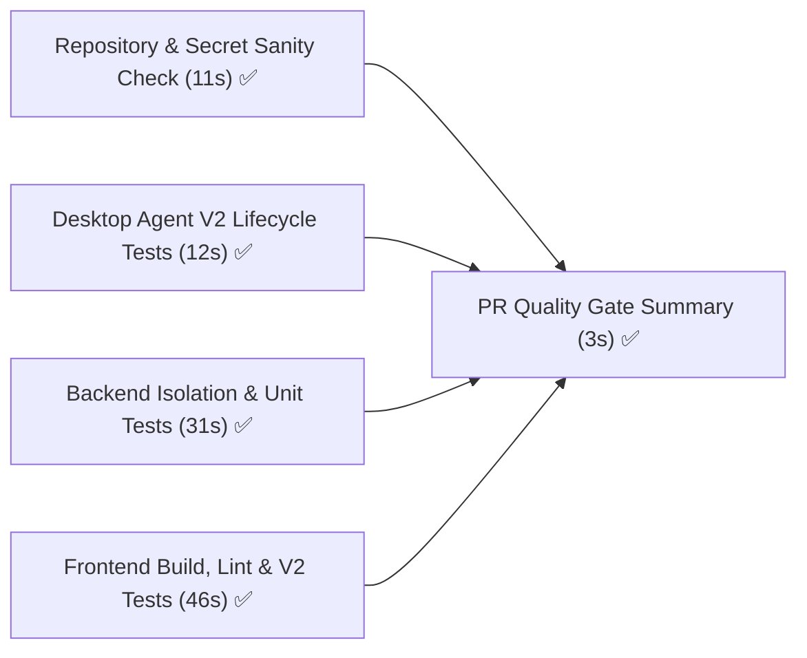

# NIYANTRAN V2 GITHUB DRAFT PR & CI/CD VERIFICATION REPORT

**Repository:** `BHIV-SYSTEM/bhiv-workflow-blackhole`  
**Execution Timestamp:** 2026-11-17T19:58:00+05:30  
**Status:** **100% CI PASS ON GITHUB ACTIONS — DRAFT PR ACTIVE**

---

## 1. Draft Pull Request Overview

- **PR Number:** `#1`
- **PR Status:** `DRAFT` (Protected from accidental merge)
- **PR URL:** [https://github.com/BHIV-SYSTEM/bhiv-workflow-blackhole/pull/1](https://github.com/BHIV-SYSTEM/bhiv-workflow-blackhole/pull/1)
- **Title:** `feat(monitoring-v2): Employee Monitoring V2 Foundation & CI Validation`
- **Head Branch:** `feature/employee-monitoring-v2-foundation`
- **Base Branch:** `main`

---

## 2. Commit SHAs & Ahead/Behind Analysis

| Entity | Branch | Commit SHA | Details |
| :--- | :--- | :--- | :--- |
| **Feature Commit** | `feature/employee-monitoring-v2-foundation` | `482ef644cae1cf71e88bf523db622b9aca363a57` | V2 foundation, isolated backend, desktop agent scaffolding, tests, docs, and PR workflow |
| **Base Commit** | `main` (Remote `origin/main`) | `300369b92c2532dae146503b2fae76fc27c29971` | "Unblock End Day with progress reminder, prompt missing progress reason + Aim reminder on Start Day, and fix telemetry modal & AI-friendly efficiency scoring" |
| **Common Ancestor** | Merge Base | `133bb6167c9c072bba5ea83ef07d7c6e00ea39c5` | Clean branch point |

### Ahead / Behind Explanation
- **Ahead by 1 commit:** Commit `482ef64` added the Employee Monitoring V2 foundation.
- **Behind by 1 commit:** Commit `300369b` on `main` by *Blackhole - 90* landed on `main` while V2 foundation was in progress.
- **Merge Conflict Status:** **CLEAN (0 CONFLICTS)**
  - Git tree resolution (`git merge-tree origin/main feature/employee-monitoring-v2-foundation`) resolved cleanly with tree hash `696dfd354bc2aa1c74e4fa7cfd850dc5dfcdba2e`.
  - Zero overlapping files: Commit `300369b` modified attendance dialogs and V1 monitoring utils, while V2 foundation strictly touched isolated V2 modules, sidebar, App routes, and bucketClient.

---

## 3. GitHub Actions CI/CD Results

- **Workflow Name:** `Pull Request Validation & Quality Gate`
- **Workflow Run ID:** `44103129600`
- **Workflow Run URL:** [https://github.com/BHIV-SYSTEM/bhiv-workflow-blackhole/actions/runs/44103129600](https://github.com/BHIV-SYSTEM/bhiv-workflow-blackhole/actions/runs/44103129600)
- **Overall Result:** **SUCCESS (All 5 jobs passed)**

### Individual Job Execution Matrix

| Job Name | Job ID | Hosted Runner | Duration | Status | Notes |
| :--- | :---: | :---: | :---: | :---: | :--- |
| **Repository & Secret Sanity Check** | `134108189563` | Ubuntu Latest | 11s | **PASS ✅** | Scanned git tracked files; zero secrets, `.env`, or keys exposed. |
| **Desktop Agent V2 Lifecycle Tests** | `134108190032` | Ubuntu Latest | 12s | **PASS ✅** | 7/7 tests passed (conflict detection, lifecycle, input counter). |
| **Backend Isolation & Unit Tests** | `134108190070` | Ubuntu Latest | 31s | **PASS ✅** | 18/18 Isolation tests PASS; 22/22 Native Node tests PASS; 140/140 Jest tests across 11 suites PASS. |
| **Frontend Build, Lint & V2 Tests** | `134108190667` | Ubuntu Latest | 46s | **PASS ✅** | Scoped ESLint PASS; 14/14 Frontend tests PASS; Production Vite build PASS (`dist/` built). |
| **PR Quality Gate Summary** | `134108717686` | Ubuntu Latest | 3s | **PASS ✅** | Asserted all 4 prerequisite jobs succeeded. |

---

## 4. Production Safety Audit Verification

1. **Production Deployment Isolation:**
   - The production deployment workflow (`.github/workflows/cicd.yml`) triggers exclusively on `push: branches: [main]`.
   - Opening Draft PR #1 triggered **only** `pr-validation.yml`. Production VM deployment was **not** invoked.
2. **Secret & Credential Boundaries:**
   - No production SSH keys, Docker credentials, or database connection strings exist in `pr-validation.yml`.
   - The runner runs in an unprivileged GitHub sandbox.
3. **Database & Runtime Boundaries:**
   - Zero production databases or external APIs were accessed.
   - All tests execute against in-memory mocks, isolated contracts, and test fixtures.
4. **Feature Isolation:**
   - `ENABLE_MONITORING_V2=false` remains the default in backend and frontend configurations.
   - V1 Employee Monitoring and all existing Niyantran routes remain 100% active and unaffected.

---

## 5. Remaining Security & Production Blockers

Before this PR is promoted from Draft to Ready for Review, merged into `main`, or deployed:

1. **GitHub Branch Protection on `main`:**
   - Require `PR Quality Gate Summary` as a mandatory status check before merge.
   - Require 1 approving review from engineering lead.
2. **Production Deployment Approval Gate:**
   - Replace automatic push-to-main deployment in `cicd.yml` with the proposed workflow in `.github/workflows/production-deploy.yml.proposed`, requiring manual approval in the `production` environment.
3. **Phase C Desktop Agent OS Drivers:**
   - Native Win32/Cocoa foreground window tracking hooks.
   - Windows Credential Manager / DPAPI encrypted storage.
4. **Phase D Live Ingestion & Backend Migration:**
   - Time-series MongoDB schema and ingestion endpoint wiring before enabling feature flags.
5. **Dependency Remediation:**
   - Non-breaking patch upgrades for `mongoose@^8.24.7`, `proxy-addr@^2.0.8`, `axios@^1.15.2`, and PDF generation migration to `pdfkit`.

---

## 6. Final Recommendation

- Keep PR #1 in **Draft** state.
- Proceed with Phase C (Desktop Agent Native OS Implementation) and Phase D (Live Ingestion APIs) in subsequent feature branches or within this branch before marking Ready for Review.
- Production VM remains completely untouched, stable, and unaffected.
