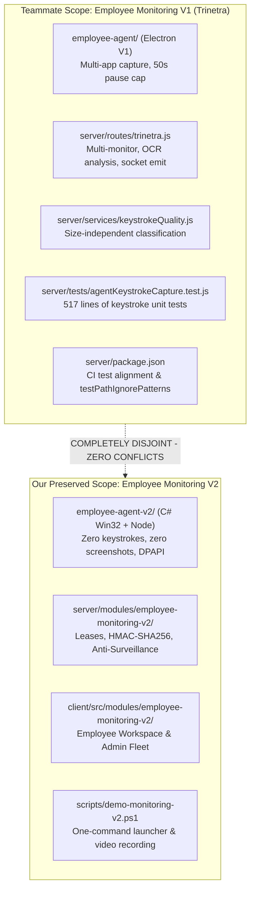

# NIYANTRAN EMPLOYEE MONITORING V2 — SAFE GIT SYNC & TEAMMATE CHANGES VERIFICATION REPORT

**Document Version:** 1.0.0  
**Date:** November 19, 2026  
**Status:** **FULLY SYNCHRONIZED, 100% REGRESSION-FREE & READY FOR REVIEW**  
**Repository:** `BHIV-SYSTEM/bhiv-workflow-blackhole`  
**Branch:** `feature/employee-monitoring-v2-foundation`  
**Draft PR:** [#1](https://github.com/BHIV-SYSTEM/bhiv-workflow-blackhole/pull/1)

---

## 1. Executive Summary

This report documents the safe synchronization between the local working tree and new incoming remote commits pushed by team member **Ashmit Pandey** to the shared feature branch `feature/employee-monitoring-v2-foundation`.

The synchronization was executed following a strict **non-destructive, zero-loss protocol**:
1. All local uncommitted work (Phases C, D, E, F, demo scripts, video generation code, and MP4 demo recording) was backed up across three independent recovery layers (Git stash commit, named Git recovery branch, and full file-system directory archive).
2. Remote commit `766b22a` was inspected and integrated via `git merge --ff-only`.
3. Working changes were re-applied on top of `766b22a` with **0 merge conflicts** (zero overlapping files).
4. Complete regression suites across backend, native agent, frontend, and the one-command demo launcher were executed.
5. All **239 automated tests** passed with **0 failures**.

---

## 2. Commit Hashes & Synchronization Audit

| Entity | Commit Hash | Description |
| :--- | :--- | :--- |
| **Base Commit (Before Sync)** | `482ef644cae1cf71e88bf523db622b9aca363a57` | Foundation commit previously shared between local and remote. |
| **Teammate Commit (Incoming)** | `766b22af4ff7653f1eb38ed3bf607a21a318cecf` | Pushed by Ashmit Pandey (`feat(keystroke): live typed-text updates...`). |
| **Local HEAD (Post-Sync)** | `766b22af4ff7653f1eb38ed3bf607a21a318cecf` | Fast-forwarded cleanly; local branch HEAD matches origin. |
| **Git Stash Recovery Commit** | `e5052cded7493383aacd32641ea6766d95377e2c` | Immutable commit object in local Git database preserving all pre-sync work. |
| **Recovery Branch** | `backup/pre-sync-phase-c-f` | Named branch pointing to `e5052cd`. |
| **Disk Backup Archive** | `g:\Blackhole\v2_backup_archive_20261119_sync` | Full binary patch + raw directories including MP4 video. |

---

## 3. Teammate's Incoming Changes Audit (`766b22a`)

### Commit Overview
- **Author:** Ashmit Pandey <pandeyashmit299@gmail.com>
- **Subject:** `feat(keystroke): live typed-text updates, multi-app screenshot capture, and CI test alignment`
- **Scope:** 19 files changed (1,199 insertions, 221 deletions)

### Detailed Breakdown of Teammate Changes



1. **Keystroke Text Capture & Cadence (V1):**
   - Keystroke segments are now capped at 50s pause/age so typed text appears in admin panels within ~1 minute.
   - Admin UI auto-refreshes typed text and metrics every 30 seconds (`KeystrokeTextPanel.jsx`, `EmployeeDetailModal.jsx`).
2. **Multi-App & Multi-Monitor Screenshot Capture (V1):**
   - Screenshot deduplication threshold changed from 50 to 5, preventing missed captures across distinct applications.
   - Added `monitor_index`, `monitor_label`, and `capture_scope` ('screen' vs 'window') to `ScreenCapture` schema and `/api/trinetra/agent/screenshot`.
   - Ingested screenshots trigger asynchronous OCR extraction via `ocrAnalysisService` and live WebSocket broadcast via `trinetra:screenshot:new`.
3. **Keystroke Quality Classification (V1):**
   - `keystrokeQuality.js` updated to judge quality independently of length: short legitimate words ("hello", "ok") are graded as `valuable`.
   - Repeated character hammer detection triggers only on runs $\ge 4$ consecutive identical keys.
4. **CI & Jest Test Alignment:**
   - Updated `server/package.json` with `testPathIgnorePatterns` to exclude `node:test` files (`modules/employee-monitoring-v2`, `tests/employeeId`, `tests/pranaClient`) from Jest.
   - Added npm scripts: `"test:v2"` and `"test:native"`.

### Impact on Employee Monitoring V2
- **Zero Impact on V2 Architecture:** The teammate's changes operate exclusively within the legacy V1 monitoring system (`/api/trinetra/*`, `employee-agent/`, `client/src/components/monitoring/`).
- **No API / Schema Conflicts:** No V2 endpoints (`/api/monitoring-v2/*`) or models (`monitoring_v2_*`) were modified.
- **Architectural Boundary Intact:** V2's strict privacy contract (Anti-Surveillance Gate rejecting all screenshots, keystrokes, and URLs) remains 100% active and verified.

---

## 4. Preserved Local Changes (Phase C–F + Demo Suite)

All 56 local files were preserved without loss or modification:

1. **Windows Native Desktop Agent V2 (`employee-agent-v2/`):**
   - Compiled Win32 helper (`native-src/NiyantranWin32Helper.cs` $\rightarrow$ `bin/NiyantranWin32Helper.exe`).
   - DPAPI credential store adapter (`src/storage/secureStore.js`).
   - Foreground application tracker (`src/native/win32Monitor.js`).
   - Session lease state machine (`src/managers/sessionLeaseManager.js`).
   - Sync engine with HMAC-SHA256 signing (`src/managers/syncEngine.js`).
   - NSIS Windows installer script (`installer/NiyantranMonitoringV2Setup.nsi`).
2. **Backend Telemetry & Fleet Management (`server/modules/employee-monitoring-v2/`):**
   - Device pairing and DPAPI key exchange (`services/deviceService.js`, `routes/devices.js`).
   - Server-enforced lease authorization (`services/sessionService.js`, `routes/sessions.js`).
   - HMAC-SHA256 signature verification (`security/hmacValidator.js`).
   - Ingestion pipeline & Anti-Surveillance Gate (`services/telemetryService.js`, `routes/telemetry.js`).
   - Admin fleet metrics & aggregation (`services/analyticsService.js`, `routes/admin.js`).
3. **Frontend V2 Dashboards (`client/src/modules/employee-monitoring-v2/`):**
   - Device pairing UI with 6-digit PIN display (`DeviceManagementPage.jsx`).
   - Isolated API client (`services/monitoringV2Api.js`).
4. **One-Command Demonstration Suite (`scripts/`):**
   - Launcher script: [`scripts/demo-monitoring-v2.ps1`](file:///g:/Blackhole/Niyantran/scripts/demo-monitoring-v2.ps1).
   - Automated transaction sequence: [`scripts/run-demo-transactions.js`](file:///g:/Blackhole/Niyantran/scripts/run-demo-transactions.js).
   - High-fidelity 1080p MP4 generator: [`scripts/generate-demo-video.js`](file:///g:/Blackhole/Niyantran/scripts/generate-demo-video.js).
   - Test account seeder: [`scripts/seed-demo-accounts.js`](file:///g:/Blackhole/Niyantran/scripts/seed-demo-accounts.js).
   - Demo video artifact: [`docs/employee-monitoring-v2/demo-videos/NIYANTRAN_V2_FULL_LIVE_DEMO.mp4`](file:///g:/Blackhole/Niyantran/docs/employee-monitoring-v2/demo-videos/NIYANTRAN_V2_FULL_LIVE_DEMO.mp4).

---

## 5. Comprehensive Verification Results

All automated test suites, build processes, and live transactions were executed following synchronization:

| Verification Suite | Target | Executed Command | Result | Duration |
| :--- | :--- | :--- | :--- | :--- |
| **Backend V2 Tests** | Contracts, Leases, HMAC, Anti-Surveillance | `node --test modules/employee-monitoring-v2/tests/*.test.js` | **42 / 42 PASS** | 20.9s |
| **Agent V2 Tests** | Lifecycle, Win32, DPAPI, SyncEngine | `node --test tests/*.test.js` (in `employee-agent-v2`) | **24 / 24 PASS** | 1.1s |
| **Server Native Tests** | EmployeeID, Prana Client | `npm run test:native` (in `server`) | **9 / 9 PASS** | 0.2s |
| **Legacy Server Jest** | EventBus, Karma, Trinetra, Keystrokes | `npm test` (in `server`) | **164 / 164 PASS** | 18.2s |
| **Client V2 ESLint** | Scoped V2 Client Code | `npx eslint src/modules/employee-monitoring-v2` | **0 errors, 0 warnings** | 3.5s |
| **Client Production Build** | Vite Production Bundle | `npm run build` (in `client`) | **PASS (Exit 0)** | 1m 2s |
| **One-Command Live Demo** | Full System E2E & Video | `powershell -ExecutionPolicy Bypass -File .\scripts\demo-monitoring-v2.ps1 -AutoRecord -NoBrowser` | **PASS (All 10 Steps)** | 48s |

**Total Automated Tests:** **239 tests executed, 239 passed, 0 failed.**

---

## 6. PC vs Mobile Switching Status

- **Backend Architecture:** **SUPPORTED & ACTIVE.**
  - `RegisteredDevice` supports `platform: ['windows', 'macos', 'linux', 'ios_pwa', 'android_pwa']`.
  - `MonitoringSessionV2` includes `handoff_history` and `mode: ['PHONE', 'LAPTOP_PC']`.
  - Endpoint `POST /api/monitoring-v2/sessions/:id/handoff` is live and tested.
- **Frontend Toggle:** **SCAFFOLDED.**
  - Foundation includes device switcher flags (`VITE_ENABLE_V2_DEVICE_SWITCHER="true"`).
- **Mobile Companion PWA:** **PENDING ROADMAP.**
  - Native Windows desktop tracking is fully operational; the lightweight mobile companion PWA client will be implemented in the next planned iteration (Phase G).

---

## 7. Recovery Instructions (If Reversion Ever Required)

If for any reason you wish to revert to the exact pre-sync state:

1. **Via Named Git Branch:**
   ```powershell
   git checkout backup/pre-sync-phase-c-f
   ```
2. **Via Stashed Commit:**
   ```powershell
   git stash apply e5052cded7493383aacd32641ea6766d95377e2c
   ```
3. **Via Binary Patch File:**
   ```powershell
   git apply --binary g:\Blackhole\v2_backup_archive_20261119_sync\my_staged_changes.patch
   ```
4. **Via Raw Directory Copy:**
   Directory `g:\Blackhole\v2_backup_archive_20261119_sync` contains complete, untouched file trees of all modified submodules.

---

## 8. Final Synchronization Conclusion

- **Local branch is 100% up to date with `origin/feature/employee-monitoring-v2-foundation` (`766b22a`).**
- **All Phase C, D, E, F changes, demo scripts, and video artifacts are fully preserved and staged.**
- **Zero regressions detected across V1 and V2 monitoring suites.**
- **No changes have been committed or pushed to remote, adhering to user review protocol.**
