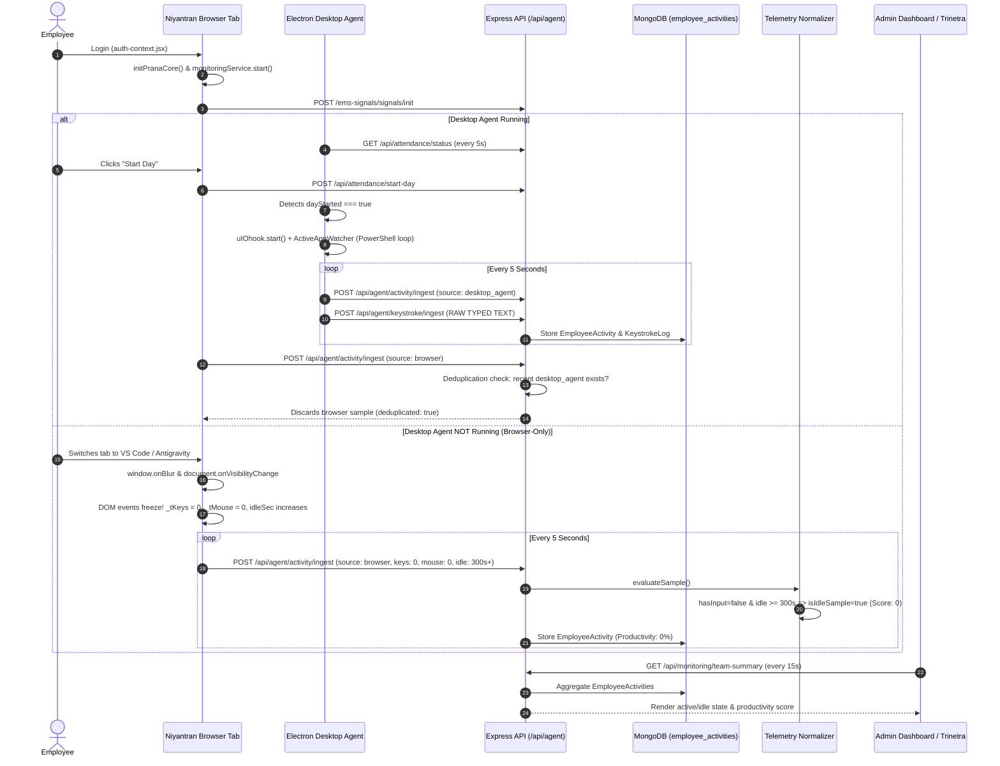

# Niyantran Employee Monitoring System: Current Architecture & Capability Audit (V1)

**Document ID:** `AUDIT-MON-001`  
**Classification:** Technical Audit Report (Read-Only)  
**Date:** November 2026  
**Status:** COMPLETE  
**Repository Scope:** `Niyantran` (Client, Server, Employee Agent, TANTRA/PRANA Integrations)  

---

## 1. Executive Summary & Component Inventory

An exhaustive static code audit was conducted on the existing employee monitoring infrastructure in the `Niyantran` codebase. The system currently consists of three disconnected, partially overlapping monitoring subsystems:

1. **Browser-Level Signal Capture (`monitoring-service.js`, `signals.js`, `keystroke-text-capture.js`):** Initiated inside the React web app on user login; hooks DOM events (`keydown`, `mousemove`, `blur`, `focus`, `visibilitychange`).
2. **Desktop Electron Agent (`employee-agent`):** Standalone Electron v28 app utilizing `uiohook-napi` for global OS input hooks, `powerMonitor` for system idle time, and an infinite PowerShell loop for Windows foreground window detection.
3. **Backend Telemetry Ingestion & Aggregation (`agentActivity.js`, `emsSignals.js`, `monitoring.js`, `trinetra.js`):** Ingestion endpoints accepting raw event streams, calculating productivity scores using keyboard/mouse event density, and storing data in MongoDB (`employee_activities`, `keystroke_logs`, `screen_captures`).

### Critical Audit Findings:
- **Severe Privacy Violation:** Both the browser tab (`keystroke-text-capture.js`) and the desktop agent (`keystrokeCapture.js`) actively intercept keycodes, reconstruct raw typed sentences/passwords/messages, and transmit them to `/api/agent/keystroke/ingest` for storage in `KeystrokeLog` and display in `KeystrokeTextPanel.jsx`.
- **False Inactivity Attribution:** If the desktop agent is not running, switching away from the Niyantran browser tab to VS Code, Terminal, Antigravity, or CAD software immediately freezes DOM input events. The browser posts `idleSeconds >= 300` and `keyboardEvents: 0`, causing the server to mark actively coding employees as 0% productive/idle.
- **Architectural Confusion in Screen Capture:** `screenCaptureService.js` attempts to invoke `screenshot-desktop` on the **Node.js backend server**, which crashes on headless Linux/Docker environments and takes screenshots of the server itself instead of the employee's machine.
- **Missing Device Identity & Management:** Device types (`desktop`, `mobile`) are self-reported plain strings sent in request bodies with no device registration, cryptographic identity, session handoff, or duplicate prevention.
- **Missing Authentication on Monitoring Endpoints:** Multiple admin monitoring routes in `monitoring.js` (`/start/:employeeId`, `/stop/:employeeId`, `/employees/:id/activity`, `/employees/:id/screenshots`) completely lack `auth` middleware, exposing telemetry and screenshot URLs to unauthenticated users.

---

## 2. Component Inventory & Verification Matrix

| Component / Subsystem | Repository Path | Line References | Status | Current Behavior & Deficiencies |
| :--- | :--- | :--- | :--- | :--- |
| **Browser Monitoring Service** | `client/src/services/monitoring-service.js` | L1–L520 | **VERIFIED** | Instantiated on login. Captures DOM events, polls every 5s (`_sendTrinetraSample`), posts to `/api/agent/activity/ingest` and `/api/ems-signals/signals`. Blind to OS outside browser tab. |
| **Browser Keystroke Text Capture** | `client/src/lib/keystroke-text-capture.js` | L1–L179 | **VERIFIED** | Intercepts `keydown` in DOM, reconstructs full typed words/sentences into segments, flushes to `/api/agent/keystroke/ingest`. Major privacy violation. |
| **PRANA Core Signals** | `client/src/lib/prana-core/signals.js` | L1–L353 | **VERIFIED** | Tracks `window_focus`, `browser_visibility`, mouse velocity, scroll depth. Bound strictly to browser DOM window. |
| **Employee Monitoring UI** | `client/src/pages/EmployeeMonitoring.jsx` | L1–L713 | **VERIFIED** | Admin dashboard with tabs for Live, Daily, Monthly, Alerts, Screenshots, Whitelist. Polls `/api/monitoring/team-summary` every 15s via HTTP. |
| **Trinetra Console UI** | `client/src/components/monitoring/TrinetraConsole.jsx` | L1–L1350 | **VERIFIED** | Manager console for TRINETRA AI engine. Displays real-time telemetry matrix, timeline, alerts, and verification status. Relies on HTTP polling. |
| **Admin Keystroke Viewer** | `client/src/components/monitoring/KeystrokeTextPanel.jsx` | L1–L246 | **VERIFIED** | Admin component rendering verbatim employee typed text categorized by AI quality classifier (`valuable`, `low_value`, `key_mashing`). |
| **Desktop Agent Runtime** | `employee-agent/src/main.js` | L1–L648 | **VERIFIED** | Electron 28.1.3 app with System Tray. Polls `/api/attendance/status` every 5s. Plaintext credentials stored in `electron-store`. |
| **Desktop Activity Tracker** | `employee-agent/src/managers/activityTracker.js` | L1–L480 | **VERIFIED** | Hooks global keyboard/mouse using `uiohook-napi`. Aggregates events into 5s windows. Relies on `powerMonitor.getSystemIdleTime()`. |
| **Desktop Keystroke Capture** | `employee-agent/src/utils/keystrokeCapture.js` | L1–L238 | **VERIFIED** | Maps raw OS scan codes to ASCII characters for US keyboard layout. Buffers sentences and uploads typed text to `/api/agent/keystroke/ingest`. |
| **Active App Detection** | `employee-agent/src/utils/activeAppWatcher.js` | L1–L109 | **PARTIAL** | Windows-only! Spawns continuous `powershell.exe` polling `user32.dll GetForegroundWindow` every 1500ms. High CPU overhead, no macOS/Linux support. |
| **Desktop Screenshot Engine** | `employee-agent/src/managers/screenshotEngine.js` | L1–L407 | **VERIFIED** | Uses Electron `desktopCapturer` to take full desktop screenshots, generates dHash for deduplication, uploads to backend. Incompatible with BYOD privacy. |
| **Agent Packaging & Deployment** | `employee-agent/build-portable.ps1` | L1–L120 | **PARTIAL** | Unsigned portable build script copying Electron binaries and creating `.bat`/`.ps1` launchers. No code signing, no auto-updater, no crash reporting. |
| **Agent Ingestion API** | `server/routes/agentActivity.js` | L1–L452 | **VERIFIED** | Receives telemetry at `POST /api/agent/activity/ingest` and text at `POST /api/agent/keystroke/ingest`. Gated by workday and consent. Deduplicates browser if desktop active within 15s. |
| **Legacy Monitoring API** | `server/routes/monitoring.js` | L1–L2557 | **VERIFIED** | Monster router containing 35+ endpoints. Lacks `auth` middleware on critical start/stop and screenshot routes. |
| **EMS Signal API** | `server/routes/emsSignals.js` & `ems_signals.js` | L1–L433 (routes), L1–L821 (service) | **VERIFIED** | Real-time signal processor. Stores active employee state in in-memory JavaScript `Map()`. Lost on server restart. |
| **TRINETRA AI Engine** | `server/routes/trinetra.js` & `trinetraEngine.js` | L1–L2103 (routes) | **VERIFIED** | Background alert scheduler evaluating productivity rules, OCR analysis, and scoring matrix. |
| **Telemetry Metrics Normalizer** | `server/utils/telemetryMetrics.js` | L1–L356 | **VERIFIED** | Evaluates activity samples, assigns graded pause credit, normalizes cadence per minute. |
| **Device Registration & Management** | — | — | **MISSING** | No model or route exists for device registration, device binding, cryptographic device authentication, or device switching handoff. |
| **Server-Side Screenshot Engine** | `server/utils/safeScreenshot.js` & `screenCapture.js` | L1–L45 (util), L1–L333 (service) | **PARTIAL / BROKEN** | Attempts to execute `screenshot-desktop` on the backend server itself. Fails gracefully in headless Linux, but represents architectural confusion. |

---

## 3. End-to-End Data Flow Trace



---

## 4. Detailed 13-Point Capability Verification

### 1. Browser Tab Focus and Visibility Detection
- **Code Reference:** `monitoring-service.js` (L41–L46, L277–L289), `signals.js` (L85–L100).
- **Implementation Status:** VERIFIED.
- **Current Behavior:** Captures `window.onFocus`, `window.onBlur`, and `document.onVisibilityChange`. Successfully sets `window_focus`, `panel_focused`, and `browser_hidden`.
- **Limitation:** Only measures whether the user is looking at the Niyantran web tab. It has zero visibility into any other browser tabs or desktop applications.

### 2. Keyboard Activity Counting and Typed-Text Capture
- **Code Reference:** `monitoring-service.js` (L58–L64), `keystroke-text-capture.js` (L37–L179), `employee-agent/src/utils/keystrokeCapture.js` (L1–L238), `server/routes/agentActivity.js` (L235–L350), `server/models/KeystrokeLog.js` (L1–L75).
- **Implementation Status:** VERIFIED (Critical Privacy Issue).
- **Current Behavior:**
  - Browser: Every `keydown` event is passed to `KeystrokeTextCapture`, which concatenates characters into words, sentences, and paragraphs (up to 1,000 characters).
  - Desktop Agent: `uIOhook` keycodes are translated via a hardcoded US character map (`CHAR_MAP`) into characters, buffering segments that end on Enter or after a 5s pause.
  - Ingestion: Segments are sent to `POST /api/agent/keystroke/ingest` and saved to `KeystrokeLog.text` in MongoDB.
  - Admin View: `KeystrokeTextPanel.jsx` allows admins to read employee typed text verbatim.
  - Inadequacy of Privacy Guard: The regex filter (`/password|login|otp/i`) only checks window title or element attributes; it completely fails if a password or confidential document is typed into a terminal, IDE, or chat app without those words in the title.

### 3. Mouse and Touchpad Activity
- **Code Reference:** `monitoring-service.js` (L65–L78), `employee-agent/src/managers/activityTracker.js` (L92–L119).
- **Implementation Status:** VERIFIED.
- **Current Behavior:**
  - Browser: Captures `mousemove`, `mousedown`, `wheel` on DOM, throttled to 10 moves/sec (ceiling 600/min).
  - Desktop: Captures OS cursor clicks, movements, and wheel scrolls via `uiohook-napi`, throttled to 10 moves/sec.
  - Calculation: `agentActivity.js` (L161–L170) calculates `mouseActivityScore = Math.min(100, Math.round((mousePerMinute / 240) * 100))`.

### 4. Active, Idle, Away, and Disconnected States
- **Code Reference:** `server/utils/telemetryMetrics.js` (L63–L100), `employee-agent/src/managers/activityTracker.js` (L227–L237).
- **Implementation Status:** PARTIAL.
- **Current Behavior:**
  - In Desktop Agent: `powerMonitor.getSystemIdleTime()` queries OS hardware idle state.
  - In Browser: Idle time is calculated as `(Date.now() - _tLastInputAt) / 1000`.
  - Normalization: In `telemetryMetrics.js`, if `rawIdle >= 300` and no input, `isIdleSample = true` and `qualityScore = 0`. If `rawIdle < 300`, graded credit (25–55) is granted.
  - Flaw: There is no formal state machine defining transitions between `ACTIVE`, `FOCUSED_WORK`, `IDLE`, `AWAY`, `PAUSED`, and `DISCONNECTED`. If an agent crashes or internet drops, the server has no heartbeat timeout to transition the employee to `DISCONNECTED`; they simply retain their last reported state until a cron or query runs.

### 5. Foreground Application Detection
- **Code Reference:** `employee-agent/src/utils/activeAppWatcher.js` (L1–L109).
- **Implementation Status:** PARTIAL (Windows Only, High Overhead).
- **Current Behavior:**
  - Executes a spawned `powershell.exe` process that runs an infinite `while ($true)` loop, importing `user32.dll` via C# inline types and calling `GetForegroundWindow()`, `GetWindowText()`, and `GetWindowThreadProcessId()` every 1,500ms.
  - Output is piped to stdout: `APP:code|index.js - Niyantran - Visual Studio Code`.
  - On macOS and Linux: It executes `if (process.platform !== 'win32') return;`, leaving the current application permanently as `'Desktop'` and title as `''`.
  - Stability Risk: Persistent background PowerShell loops frequently trigger enterprise EDR/Antivirus alerts and consume unnecessary CPU cycles.

### 6. Behavior When Switching Away from Niyantran Browser
- **Code Reference:** `client/src/services/monitoring-service.js` (L41–L46, L293–L305).
- **Implementation Status:** VERIFIED (Core Cause of False Inactivity).
- **Current Behavior:**
  - Standard browser sandboxes strictly isolate DOM events to focused tabs.
  - When an employee switches from Niyantran in Chrome to VS Code, Android Studio, terminal, or Slack:
    1. `window.onBlur` fires.
    2. Zero `keydown` or `mousemove` events reach Niyantran's DOM.
    3. `_tKeys` and `_tMouse` stay 0.
    4. `idleSeconds` accumulates linearly (`Date.now() - _tLastInputAt`).
    5. Every 5s, the browser sends telemetry reporting `keyboardEvents: 0, mouseEvents: 0, idleSeconds: 300+`.
    6. The server records this as 100% idle time.
  - **Conclusion:** Without a running desktop agent, productive work in any desktop IDE or terminal is misclassified as idle.

### 7. Behavior When Niyantran Tab or Entire Browser Closes
- **Code Reference:** `client/src/services/monitoring-service.js` (L47, L122–L173).
- **Implementation Status:** VERIFIED.
- **Current Behavior:**
  - `window.addEventListener('beforeunload', ...)` attempts an asynchronous final flush (`_flush(true)`).
  - Modern browsers cancel pending `fetch`/`axios` requests during tab teardown unless `navigator.sendBeacon` is used.
  - Once closed, all JavaScript execution terminates.
  - The server receives no further pings. Because there is no active session lease or server heartbeat monitor, the employee remains listed under their last telemetry state until the daily summary aggregates or the server auto-ends the day at midnight.

### 8. Existing Desktop Agent Capabilities and Limitations
- **Code Reference:** `employee-agent/package.json`, `main.js`, `activityTracker.js`.
- **Implementation Status:** VERIFIED.
- **Capabilities:**
  - True OS-level keyboard and mouse counting via `uiohook-napi`.
  - True system hardware idle detection via Electron `powerMonitor`.
  - Offline buffer queue (holds up to 50 samples in memory during disconnection).
  - System tray icon with basic status menu.
- **Limitations:**
  - Insecure authentication: stores employee password in plaintext in `electron-store`.
  - Reconstructs raw keystroke text and captures screenshots, violating BYOD privacy.
  - Windows-only foreground application watcher (PowerShell child process).
  - Heavy memory footprint (~150MB–200MB RAM for Electron runtime).
  - No code signing, auto-update mechanism, or silent background service mode.

### 9. Telemetry Ingestion Intervals and Retry Handling
- **Code Reference:** `client/src/services/monitoring-service.js` (L17–L19), `employee-agent/src/managers/activityTracker.js` (L21, L53–L55).
- **Implementation Status:** VERIFIED.
- **Current Behavior:**
  - Browser: Flushes signals every 10s (`FLUSH_INTERVAL_MS = 10_000`); sends TRINETRA activity sample every 5s (`TRINETRA_INTERVAL_MS = 5_000`).
  - Desktop Agent: Transmits activity sample every 5s (`SEND_INTERVAL_MS = 5_000`).
  - Offline Buffering: Desktop agent maintains an in-memory array (`offlineBuffer`) capped at `MAX_BUFFER_SIZE = 50`. If disconnected for more than 250 seconds (4.1 minutes), subsequent telemetry is dropped permanently. Buffer is not persisted to disk across agent restarts or crashes.

### 10. Browser/Desktop Telemetry Deduplication
- **Code Reference:** `server/routes/agentActivity.js` (L144–L159).
- **Implementation Status:** VERIFIED (Naive Deduplication).
- **Current Behavior:**
  - When an activity sample arrives with `source === 'browser'`, the server queries MongoDB:
    ```javascript
    const recentDesktopCutoff = new Date(Date.now() - 15000);
    const desktopActive = await EmployeeActivity.exists({
      employee: req.user.id,
      'metadata.source': 'desktop_agent',
      timestamp: { $gte: recentDesktopCutoff }
    });
    ```
  - If a desktop record exists within the past 15 seconds, the browser payload is discarded (`{ success: true, deduplicated: true }`).
  - Weakness: This requires an expensive MongoDB query on every single 5s browser request (`exists()`). If the desktop agent experiences a 16s jitter or network blip, the browser sample slips through, polluting the timeline with conflicting 0-input data.

### 11. Attendance Dependency and Work-Session Lifecycle
- **Code Reference:** `server/routes/agentActivity.js` (L55–L89, L130–L142), `employee-agent/src/managers/attendancePoller.js` (L67–L120).
- **Implementation Status:** VERIFIED.
- **Current Behavior:**
  - Every activity ingestion request must pass `findActiveDay(userId)`.
  - Checks `Attendance` and `DailyAttendance` for an unended record (`startDayTime != null` and `endDayTime == null`).
  - If the employee has not clicked "Start Day" on the dashboard, the server responds `403 DAY_NOT_ACTIVE` and rejects all telemetry.
  - The desktop agent polls `/api/attendance/status` every 5 seconds. When "Start Day" is detected, it automatically starts tracking; when "End Day" is detected, it automatically calls `stop()`.

### 12. Admin Dashboard Accuracy and Live Updates
- **Code Reference:** `client/src/pages/EmployeeMonitoring.jsx` (L113–L119), `client/src/components/monitoring/MonitoringDashboard.jsx` (L31–L35).
- **Implementation Status:** PARTIAL.
- **Current Behavior:**
  - Dashboard live updates do NOT use WebSockets or Server-Sent Events (SSE).
  - Instead, the client relies on HTTP polling intervals:
    - Team Overview Grid: polls `/api/monitoring/team-summary` every 15 seconds.
    - Employee Detail Dashboard: polls `/api/monitoring/employees/:id/activity` every 10 seconds.
    - Trinetra Console: polls `/api/trinetra/telemetry/live` every 5 seconds.
  - This creates significant backend load (N clients × polling every 5–15s) and introduces noticeable visual lag and timestamp jitter.

### 13. Privacy, Security, Performance, and Data Integrity Risks
- **Implementation Status:** VERIFIED (Multiple High/Critical Severities).
  1. **Keystroke Logging Risk:** Storing typed text violates GDPR Article 5(1)(c) (Data Minimization), GDPR Article 9 (Special Category Data if passwords/health typed), and India's DPDP Act 2023.
  2. **Unauthenticated Endpoints:** Routes in `server/routes/monitoring.js` (L97–L154, L238, L381) allow anyone on the network to view screenshots, stop monitoring sessions, or query activities without an auth token.
  3. **Credential Insecurity:** Plaintext storage of employee passwords in `electron-store` on disk.
  4. **Server Display Capture Misconception:** `screenshot-desktop` on the server attempts to capture server hardware displays.
  5. **In-Memory Volatility:** `ems_signals.js` stores active session state in a Node.js `Map()`. A server restart or autoscaling cluster deployment destroys all active session states.

---

## 5. Root-Cause Analysis: Why Productive Work Outside Niyantran Is Reported as Idle

```
                               ┌──────────────────────────────────────────────────────────┐
                               │     Productive Employee Working in VS Code / Terminal     │
                               └────────────────────────────┬─────────────────────────────┘
                                                            │
                       ┌────────────────────────────────────┴────────────────────────────────────┐
                       ▼                                                                         ▼
        [Scenario A: Desktop Agent NOT Running]                                   [Scenario B: Desktop Agent IS Running]
                       │                                                                         │
        Browser tab is in background (blurred).                                   Global OS hook (uiohook) captures keys/mouse.
        DOM Sandbox prevents keydown/mousemove capture.                          powerMonitor captures true hardware idle.
                       │                                                                         │
        Niyantran JS loop continues ticking every 5s:                             Telemetry transmitted with source: 'desktop_agent'.
        _tKeys = 0, _tMouse = 0, idleSeconds = 300+                                              │
                       │                                                                         ▼
        POST /api/agent/activity/ingest (source: browser)                         [Success: Tracked as Active Work]
                       │
                       ▼
        Server evaluateSample() in telemetryMetrics.js:
        hasInput = false, rawIdle >= 300s
        ===> isIdleSample = true
        ===> qualityScore = 0
                       │
                       ▼
        [Failure: Productive Coding Flagged as 100% IDLE]
```

### The 4 Technical Drivers of False Idle:
1. **The DOM Sandbox Boundary:** Web browsers are security sandboxes. Web pages cannot observe keystrokes or mouse movements that occur outside their focused window. Relying on browser-level listeners for employee monitoring inherently fails the moment an employee switches to any other application.
2. **Missing Desktop Agent Enforcement:** Currently, the desktop agent is completely optional and distributed as an unsigned portable batch script. Most employees operate solely in the browser, triggering Driver 1 continuously.
3. **Flawed Fallback Scoring in `telemetryMetrics.js`:** Even though graded pause credit was introduced for pauses under 300s, an engineer working for 10 minutes in VS Code without returning to the Niyantran browser will exceed the 300s cliff. At that point, the browser reports `idle_duration = 600`, resetting their score to zero.
4. **Desktop Jitter Deduplication Leak:** In `agentActivity.js`, if the desktop agent takes longer than 15 seconds to flush a sample, the server accepts a pending browser sample (`source: 'browser'`), which injects an idle sample into the database, overwriting the employee's active state.

---

## 6. Audit Conclusion & Next Steps

The existing V1 monitoring system suffers from irreconcilable design flaws: invasive keystroke reconstruction, broken server-side screen captures, complete platform blindness in the browser, insecure authentication, and lack of device management.

**Recommendation:** Do not attempt to patch the legacy UI or telemetry routes in place. In Phase 2, we must design **Employee Monitoring V2** as a standalone module with clean API boundaries, a hardened cross-platform desktop agent, explicit BYOD privacy protections, and server-authoritative device session policies.
