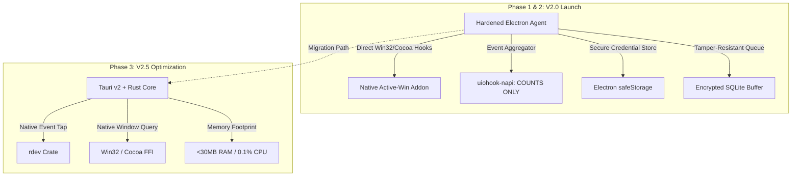

# Desktop Agent Feasibility Study: Architecture, Runtime Selection & Cross-Platform Roadmap

**Document ID:** `FEASIBILITY-AGT-002`  
**Classification:** Technical Evaluation & Architectural Decision Record (ADR)  
**Date:** November 2026  
**Status:** COMPLETE  
**Scope:** Evaluation of Existing vs. Proposed Desktop Agent Technologies for Niyantran V2  

---

## 1. Executive Feasibility Verdict

### Can the existing Electron agent be upgraded, or does it require replacement?
**Verdict: UPGRADE & HARDEN (Phase 1–2), with a staged migration path to TAURI v2 + RUST (Phase 3).**

While the existing desktop agent has severe design flaws in its current state (plaintext credentials, PowerShell execution loops, privacy-violating text reconstruction, and unsigned distribution), its fundamental native hook library (`uiohook-napi`) and Electron `powerMonitor` APIs are functionally sound. 

Replacing the runtime immediately with a brand-new native stack (such as pure Rust/C#) would require rewriting the entire IPC layer, system tray, HTTP client, local cache, and window renderer from scratch. 

However, running a production enterprise agent on unhardened Electron with shell-spawned PowerShell commands is unacceptable for production stability and battery life. 

Therefore, the architectural recommendation is a **Two-Stage Strategy**:
1. **Short-Term (Immediate V2 Foundation): Electron Hardened Agent (V2.0)**
   - Strip all keystroke reconstruction and screen capturing code.
   - Replace the persistent PowerShell child process with a native C++ Win32/macOS Node addon (`get-windows` or precompiled native FFI binding) for foreground application detection.
   - Secure local secrets using OS keychain (via `keytar` or Electron `safeStorage`).
   - Implement cryptographically signed auto-updates via GitHub Releases / S3.
2. **Medium/Long-Term (High Performance & Scale): Tauri v2 + Rust Agent (V2.5)**
   - Drop runtime footprint from ~180MB RAM to <30MB RAM.
   - Leverage native Rust threads for global input hooks (`rdev`), zero-alloc ring buffers, and OS-native event queues.
   - Eliminate all node-gyp native compilation friction across macOS architectures (x86_64 and arm64 Apple Silicon) and Linux distributions.

---

## 2. In-Depth Architectural Comparison Matrix

| Evaluation Dimension | 1. Existing Implementation (`employee-agent`) | 2. Hardened Electron Runtime (Proposed V2.0) | 3. Tauri v2 + Rust (Recommended V2.5) | 4. Native Headless Daemon (Go / C# / Rust) + Tray |
| :--- | :--- | :--- | :--- | :--- |
| **Runtime / Engine** | Electron 28.1.3 + Node.js (raw) | Electron 31+ LTS + Node.js (hardened) | Rust 1.78+ & OS Webview (WebKit / WebView2) | Pure Compiled Binary (Go runtime or Rust) |
| **Binary Size** | ~180 MB unpacked | ~120 MB (packaged with ASAR) | **~15 MB - 25 MB** | **~10 MB - 18 MB** |
| **Idle Memory (RAM)** | 160 MB – 240 MB (3-4 processes) | 120 MB – 160 MB (optimized) | **25 MB – 45 MB** | **12 MB – 25 MB** |
| **Active CPU Load** | 3.5% – 8.0% (due to PowerShell polling) | < 0.5% (native Win32/macOS APIs) | **< 0.2%** (native event driven) | **< 0.1%** |
| **Input Hook Tech** | `uiohook-napi` (scan codes mapped to chars) | `uiohook-napi` (counts only; raw text deleted) | Native `rdev` / OS event tap (counts only) | Raw Win32 Hooks (`SetWindowsHookEx`) / Quartz |
| **Active App Tracking** | Persistent PowerShell loop (`user32.dll`) | Native addon / `active-win` native binding | Native Win32 / Cocoa / X11 C-FFI calls | Native OS API calls |
| **Security / Storage** | Insecure: plaintext passwords in JSON | Secure: Electron `safeStorage` (DPAPI/Keychain) | Secure: OS Keychain via `keyring-rs` | Secure: Windows DPAPI / macOS Keychain |
| **macOS Compatibility** | Broken (PowerShell watcher fails) | Full (Cocoa `NSWorkspace` for active app) | Full (CoreGraphics + Cocoa Event Taps) | Full (Requires separate Swift GUI wrapper) |
| **Linux Compatibility** | Partial (X11 only; crashes on Wayland) | Partial (X11 supported; Wayland input restricted) | Partial (X11 full; Wayland via portal/XWayland) | Partial (Daemon requires D-Bus service) |
| **Packaging & Updates** | Unsigned ZIP + `.bat` launcher | Signed NSIS (`.exe`), DMG (`.dmg`), AppImage | Signed MSI / NSIS, DMG, AppImage (`tauri-updater`) | Custom MSI / `.pkg` installer |
| **Developer Velocity** | Rapid (JavaScript / Web technologies) | High (Shared JS ecosystem with client) | Medium (Requires Rust + React skills) | Low (Separate platform codebases C#/Swift) |
| **Battery Impact** | Moderate/High (due to constant sub-process) | Negligible (< 1% daily battery drain) | **Minimal (< 0.2% daily battery drain)** | **Minimal** |

---

## 3. Platform Compatibility & OS Permissions Analysis

### A. Windows (Windows 10 & Windows 11)
- **Privilege Level:** Must run in **User Space** (standard non-elevated user). Under no circumstances should the monitoring agent require Administrator / UAC elevation for daily operation.
- **Input Monitoring:** `uiohook-napi` utilizes standard Windows low-level hooks (`WH_KEYBOARD_LL`, `WH_MOUSE_LL`). These hooks work seamlessly in standard user sessions without triggering security prompts.
- **Active Window Detection:** Replaces the PowerShell child process with direct Win32 C++ calls:
  - `GetForegroundWindow()` -> `GetWindowThreadProcessId()` -> `QueryFullProcessImageNameW()`
  - Execution overhead drops from 200ms per check to < 0.05ms.
- **Auto-Startup:** Register an entry in `HKEY_CURRENT_USER\Software\Microsoft\Windows\CurrentVersion\Run` or place a shortcut in `%APPDATA%\Microsoft\Windows\Start Menu\Programs\Startup`.

### B. macOS (macOS 13 Ventura, 14 Sonoma, 15 Sequoia)
- **Mandatory Permissions (TCC - Transparency, Consent, and Control):**
  - **Input Monitoring (`kTCCServiceListenEvent`):** Required for global keyboard and mouse event counting. The OS prompts the user: *"Employee Agent would like to receive keystrokes from any application."*
  - **Accessibility (`kTCCServiceAccessibility`):** Required if active window titles or UI states are queried via Accessibility APIs.
  - **Screen Recording (`kTCCServiceScreenCapture`):** NOT REQUIRED in V2 because raw screenshot streaming is strictly eliminated for BYOD privacy.
- **Active Window Detection:** Uses `NSWorkspace.shared.frontmostApplication` to retrieve process name, bundle identifier, and window title without polling subprocesses.
- **Code Signing & Notarization:** Mandatory for macOS. Unnotarized binaries will be blocked by Apple Gatekeeper. The build pipeline must sign binaries with an Apple Developer ID and notarize via `xcrun notarytool`.

### C. Linux (Ubuntu 20.04/22.04/24.04, Debian, Fedora)
- **X11 vs. Wayland Paradigm:**
  - **X11:** Global input hooks via `XRecord` or `uiohook` operate without restriction.
  - **Wayland (Default in modern Ubuntu/Fedora):** For security, Wayland strictly forbids background applications from eavesdropping on global keystrokes or mouse events of other windows.
  - **Architectural Solution for Wayland:**
    - Option 1: Standard XWayland compatibility layer (covers applications running under XWayland).
    - Option 2: Linux systemd user daemon reading `/dev/input/event*` nodes (requires membership in the `input` user group: `sudo usermod -a -G input $USER`).
    - Option 3: For BYOD users on Wayland where root group modification is undesirable, fall back to "Verified Focus Mode" (detecting active workspace and active process via `org.freedesktop.portal.Desktop`).

---

## 4. Mandatory Architectural Requirements for V2 Agent

1. **Strict Browser Independence:**
   - The desktop agent must execute as an independent, long-running tray application.
   - Telemetry collection must continue uninterrupted during an authorized work session regardless of whether the Niyantran web tab is minimized, navigated away from, or completely closed.
2. **Server-Authoritative Work Session Binding:**
   - The agent does not decide when a workday starts or stops.
   - It maintains a persistent WebSocket connection or 30-second heartbeat lease with the backend.
   - It tracks activity **only** while the employee's server-side session status is `ACTIVE`.
3. **No Invasive Surveillance:**
   - Zero raw keystroke reconstruction.
   - Zero screen recording / full-frame capture.
   - Zero clipboard inspection.
   - Zero access to microphone or webcam.
4. **Resilient Local Encrypted Buffering:**
   - During network disruptions or laptop travel, telemetry samples must be queued locally in an encrypted SQLite or leveldb ring buffer (`AES-256-GCM`).
   - When connection is restored, buffered telemetry is synchronized idempotently using batch sequence nonces.
5. **System State & Power Awareness:**
   - Must hook OS power events:
     - `suspend` / `sleep`: Immediately pauses telemetry collection and notifies backend.
     - `resume`: Re-verifies session validity before resuming telemetry ticks.
     - `lock-screen`: Transitions state to `AWAY` or `LOCKED`.

---

## 5. Technology Decision & Implementation Roadmap

### Strategic Recommendation:
1. **Immediately refactor `employee-agent` into `niyantran-desktop-agent-v2`** using the Hardened Electron architecture:
   - Purge `src/utils/keystrokeCapture.js`.
   - Purge `src/managers/screenshotEngine.js`.
   - Remove `getActiveApp.ps1` and replace with `@arcsine/win-info` or precompiled native addon.
   - Implement `safeStorage` for tokens.
2. **Maintain clean, modular IPC and API contracts** so that when the Tauri v2 Rust core is compiled in Phase 3, the backend ingestion endpoints and UI dashboards require **zero changes**.
