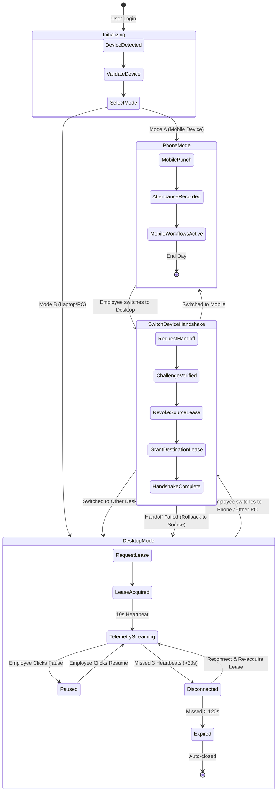

# Device Management & Work-Session Policy: 3-Mode Device Architecture

**Document ID:** `POLICY-DEV-004`  
**Classification:** Policy Specification & Protocol Design  
**Date:** November 2026  
**Status:** COMPLETE  
**Scope:** Device Modes, Session Ownership, Heartbeat Lease, and Handoff Protocols  

---

## 1. Executive Policy Framework

In modern hybrid engineering environments, employees routinely transition between mobile devices and desktop workstations. Niyantran V2 establishes an explicit, server-authoritative **Three-Mode Device Architecture** to eliminate ambiguity, prevent accidental idle penalties, and support flexible BYOD workflows:

```
               ┌─────────────────────────────────────────────────────────┐
               │           NIYANTRAN 3-MODE DEVICE ARCHITECTURE          │
               └────────────────────────────┬────────────────────────────┘
                                            │
        ┌───────────────────────────────────┼───────────────────────────────────┐
        ▼                                   ▼                                   ▼
 ┌───────────────┐                  ┌───────────────┐                  ┌─────────────────┐
 │   A. PHONE    │                  │ B. LAPTOP/PC  │                  │C. SWITCH DEVICE │
 └───────┬───────┘                  └───────┬───────┘                  └────────┬────────┘
         │                                  │                                   │
 • Mobile Attendance (GPS/Biometric)• Verified Registered Desktop Agent• Cryptographic Session Transfer
 • Mobile Workflows (Review/Chat)   • OS-Level Activity Ingestion      • Lease Migration Handshake
 • Non-Monitored (Zero Idle Penalty)• Visible Tray & Pause Controls    • Mutual Exclusion Enforcement
 • Configurable Role Exceptions     • Active/Focused Work Accounting   • Atomic Rollback on Failure
```

---

## 2. Mode Specifications

### Mode A: Phone (Mobile Workflows & Field Presence)
- **Target Environments:** iOS, Android (via Mobile Web App, PWA, or future native container).
- **Core Capabilities:**
  - Secure authentication via OAuth / Pravesh SSO / Credentials.
  - Mobile Attendance Punch (GPS geofencing, selfie verification, or office Wi-Fi SSID validation).
  - Mobile-appropriate workflows: reviewing task status, viewing aims, approving procurement requests, chat/notifications, and viewing personal attendance history.
- **Monitoring Policy (Strict Non-Surveillance):**
  - **No Background Telemetry:** Mobile browsers and operating systems will NOT run background key/mouse/activity monitors.
  - **Zero False Idle Penalty:** Time spent logged in on a phone is explicitly tagged as `MODE: PHONE_WORKFLOW`. It is NEVER penalized as "idle desktop time" or scored with 0% productivity.
  - **Configurable Organizational Policies:**
    - *Full-Time Remote Coders:* Mobile attendance allows check-in, but work session must transition to a verified Laptop/PC to accumulate verified focused coding hours.
    - *Physical Engineering / QA / Leadership:* Configurable policy allows full-day credit for mobile-driven field inspections and reviews without requiring desktop agent telemetry.
  - **Integrity Rule:** Using a phone for daily check-in or quick communications must **never** automatically invalidate an active or completed workday.

### Mode B: Laptop / PC (Verified Monitored Workstation)
- **Target Environments:** Windows 10/11, macOS, Linux (Enterprise or BYOD).
- **Core Capabilities:**
  - Device Registration: Every computer must be registered once via the V2 interface, generating a unique `deviceId` and cryptographic secret.
  - Agent Verification: The background Desktop Agent authenticates using a scoped `DeviceToken` (not the user's raw password).
  - Independent OS Telemetry: Aggregates permitted input events (keystroke counts, mouse activity delta) and active process category completely independent of the Niyantran browser state.
- **Session Lifecycle:**
  - The employee initiates an explicit monitored work session (`POST /api/v2/sessions/start`).
  - The agent acquires a server-authoritative **Session Lease** (valid for 60 seconds, renewed every 10 seconds via telemetry heartbeat).
  - The system tray icon turns green (`● Monitored Work Active`).
- **Employee Transparency & Control:**
  - Visible floating or tray widget displaying current session status and active categorization.
  - Employee pause control: Employee can pause monitoring for breaks/personal tasks (up to configurable max duration, e.g., 60 mins/day). During pause, the agent halts all event aggregation.

### Mode C: Switch Device (Zero-Downtime Session Handoff)
- **Objective:** Enable an employee working on Laptop A (e.g., Office Desktop) to transition seamlessly to Laptop B (e.g., Home Laptop) or Phone without losing their attendance record, splitting workday summaries, or triggering concurrent duplicate monitoring.
- **Mutual Exclusion Guarantee:** At any given second, a user can have only **one** device holding an active monitored lease.
- **Handoff Protocol:**
  1. **Transfer Request:** Employee requests handoff on Destination Device (Device B) via QR Code Scan, In-App Prompt, or Secondary Password Confirmation.
  2. **Server Verification:** Backend verifies Device B registration, generates a transfer challenge (`transferToken`), and notifies Origin Device (Device A).
  3. **Lease Revocation on Source:** Backend revokes the session lease for Device A. On Device A's next 10-second heartbeat, it receives `409 LEASE_TRANSFERRED_TO_ANOTHER_DEVICE` and cleanly halts monitoring, flushing any remaining buffered telemetry.
  4. **Lease Activation on Destination:** Backend binds the active session ID to Device B and issues a fresh lease.
  5. **Rollback on Failure:** If Device B fails to complete the handshake or disconnects within 60 seconds, the transfer is aborted, and Device A is permitted to resume its lease without data loss.

---

## 3. Server-Authoritative Session Ownership & Heartbeat Protocol



---

## 4. Lease Validation & Heartbeat Specifications

| Parameter | Specification | Purpose |
| :--- | :--- | :--- |
| **Telemetry Cadence** | Every 10 seconds | Frequency at which agent flushes aggregated counters to `/api/v2/monitoring/ingest`. |
| **Lease Duration** | 60 seconds | Server-granted lease lifetime. If no heartbeat arrives within 60s, lease expires. |
| **Grace Period** | 30 seconds (Total 90s) | Window during which agent can reconnect and renew lease before transitioning to `DISCONNECTED`. |
| **Stale Timeout** | 120 seconds | Period after which a disconnected session is frozen and flagged for manager review. |
| **Heartbeat Payload** | `{ sessionId, sequenceNum, activeDuration, currentAppCat, checksum }` | Lightweight payload confirming health and active state. |
| **Server Response** | `{ leaseExpiresAt, command: 'CONTINUE' \| 'PAUSE' \| 'TERMINATE' \| 'SWITCH' }` | Authoritative server commands controlling agent behavior. |

---

## 5. Security & Multi-Device Collision Safeguards

1. **Replay Protection:** Telemetry requests require a monotonically increasing sequence counter (`seq`). If an attacker or network proxy duplicates a payload, the server rejects it as duplicate.
2. **Device Token Scoping:** A `DeviceToken` cannot perform general user actions (like updating profile or changing salary). It can **only** submit telemetry and renew leases for its specific registered `deviceId`.
3. **Simultaneous Monitoring Denial:** If two agents attempt to stream telemetry for the same user concurrently, the server compares the device IDs:
   - The device with the active lease is maintained.
   - The competing device is rejected with `409 DUPLICATE_MONITORING_REJECTED`.
   - A critical security audit entry is logged to `device_audit_logs`.
4. **Audit Trail Preservation:** When switching devices, all historical telemetry segments remain immutable and explicitly tagged with the `deviceId` that captured them. The unified daily session rolls up metrics across both devices without disjoint timelines.
