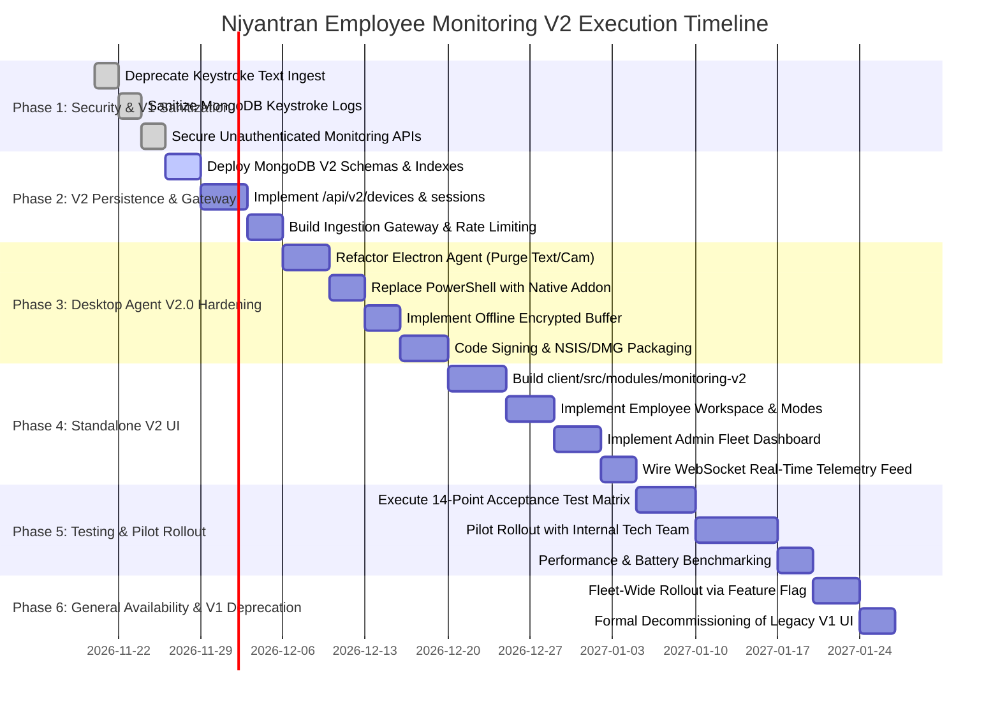

# Employee Monitoring V2: Implementation Roadmap & Migration Strategy

**Document ID:** `ROADMAP-EXEC-008`  
**Classification:** Engineering Execution Plan & Milestones  
**Date:** November 2026  
**Status:** COMPLETE  
**Scope:** Staged Rollout, Feature Flags, Workstreams, Effort Estimation & Risk Controls  

---

## 1. Master Phase Sequence & Workstream Dependencies

The implementation is structured into **6 discrete, dependency-ordered phases** to guarantee zero downtime, protect running operations, and isolate new V2 code completely from legacy systems until verification is signed off.



---

## 2. Phase-by-Phase Deliverables & Acceptance Criteria

### Phase 1: Immediate Security Remediation & V1 Sanitization
- **Objectives:** Neutralize active security and privacy liabilities in the running system.
- **Deliverables:**
  - `POST /api/agent/keystroke/ingest`: Updated to discard text payload and return 200 without inserting into `KeystrokeLog`.
  - Database Sanitization Script: Run on MongoDB to wipe `text` and `window_title` fields across all historical `keystroke_logs`.
  - Auth Middleware: Inject `auth` middleware across vulnerable endpoints in `server/routes/monitoring.js` (`/start/:employeeId`, `/stop/:employeeId`, `/employees/:id/activity`, `/employees/:id/screenshots`).
- **Acceptance Criteria:**
  - Zero raw text segments saved to MongoDB.
  - Unauthenticated curl requests to `/api/monitoring/employees/test/activity` return `401 Unauthorized`.

---

### Phase 2: V2 Persistence Tier & Edge Gateway
- **Objectives:** Deploy decoupled V2 database schemas and build the server-authoritative state engine.
- **Deliverables:**
  - Create Mongoose models: `RegisteredDevice.js`, `MonitoringSessionV2.js`, `AggregatedTelemetryV2.js`, `DeviceAuditLog.js`.
  - Build Express routers: `server/routes/v2/devices.js`, `server/routes/v2/sessions.js`, `server/routes/v2/monitoring.js`.
  - Implement HMAC signature validation and monotonic sequence checking.
  - Implement lease timer and 60-second heartbeat validation.
- **Acceptance Criteria:**
  - Device registration successfully returns device UUID and secret.
  - Ingestion endpoint rejects requests with invalid HMAC signatures or clock skew > 120s.

---

### Phase 3: Desktop Agent V2.0 Hardening
- **Objectives:** Transform `employee-agent` into a robust, privacy-first, cross-platform enterprise agent.
- **Deliverables:**
  - Purge `keystrokeCapture.js` and `screenshotEngine.js`.
  - Replace `getActiveApp.ps1` with native Win32/Cocoa bindings.
  - Implement local ring buffer (`better-sqlite3` or encrypted JSON file) with AES-256-GCM.
  - Implement system tray menu with 1-click Pause/Resume controls.
  - Build automated CI pipeline for code signing and packaging (NSIS for Windows, DMG for macOS).
- **Acceptance Criteria:**
  - Agent consumes < 150MB RAM and < 0.5% CPU during active coding.
  - Background PowerShell process is eliminated completely.
  - Network disconnection buffers telemetry locally and syncs cleanly upon reconnect without duplicate records.

---

### Phase 4: Standalone V2 UI Implementation
- **Objectives:** Construct the new `Employee Monitoring V2` React module in the Niyantran client.
- **Deliverables:**
  - Scaffold `client/src/modules/monitoring-v2/` with context, hooks, and components.
  - Build `EmployeeWorkspaceView.jsx` (Session hero, Mode selector, Health widget, 1-minute bucket timeline).
  - Build `AdminFleetView.jsx` (Real-time team presence, Device inventory table, Focus distribution).
  - Add `Employee Monitoring V2` sidebar link in `DashboardSidebar.jsx`.
- **Acceptance Criteria:**
  - Legacy `/monitoring` route and UI remain 100% functional and unmodified.
  - Switching between Phone, Laptop, and Switch Device updates the UI in < 1 second.

---

### Phase 5: Testing, Pilot Rollout & Fleet Benchmarking
- **Objectives:** Validate performance, battery impact, and edge cases under real employee workloads.
- **Deliverables:**
  - Execute the 14-Point Acceptance Test Matrix (`TESTING_ACCEPTANCE_MATRIX.md`).
  - Deploy to Pilot Group (15 engineers across Windows, macOS, and Linux).
  - Collect telemetry latency and battery benchmark reports.
- **Acceptance Criteria:**
  - Zero false idle flags reported when working in VS Code, terminal, or CAD software.
  - Laptop battery drain < 1% over an 8-hour workday.

---

### Phase 6: General Availability & V1 Deprecation
- **Objectives:** Roll out V2 fleet-wide and decommission legacy V1 monitoring.
- **Deliverables:**
  - Flip feature flag `MONITORING_V2_ENABLED = true` for all organization tenants.
  - Archive legacy desktop agent installers.
  - Deprecate `/api/monitoring` and redirect `/monitoring` to `/monitoring-v2`.
- **Acceptance Criteria:**
  - 100% of active employees reporting on V2 engine.
  - Zero dependency on legacy `EmployeeActivity` or `KeystrokeLog` collections.

---

## 3. Feature Flag & Rollback Strategy

```javascript
// server/config/featureFlags.js
const FEATURE_FLAGS = {
  // Master switch for V2 backend ingestion and UI visibility
  MONITORING_V2_ENABLED: process.env.FF_MONITORING_V2_ENABLED === 'true',
  
  // Controls desktop agent distribution (v1 legacy vs v2 hardened)
  AGENT_V2_ROLLOUT_PERCENTAGE: parseInt(process.env.FF_AGENT_V2_PERCENTAGE || '0', 10),
  
  // Hard kill-switch to immediately pause all telemetry ingestion if anomalies arise
  EMERGENCY_TELEMETRY_HALT: false
};
```

### Rollback Protocols:
1. **Frontend Rollback:** Set `FF_MONITORING_V2_ENABLED = false`. The sidebar immediately hides the V2 menu entry; existing legacy routes continue unaffected.
2. **Backend Rollback:** The `/api/v2/*` routes are mounted independently in `index.js`. If any regression occurs, disabling the route mount leaves all core Niyantran services (Tasks, Attendance, Salary, Auth) completely unharmed.
3. **Agent Rollback:** The agent checks `/api/v2/monitoring/policy` on startup. Setting `serverCommand: 'STANDBY'` instructs agents to pause tracking and remain idle in the system tray.

---

## 4. Engineering Effort & Resource Estimation

| Workstream | Scope & Key Tasks | Estimated Effort | Engineering Assumptions |
| :--- | :--- | :--- | :--- |
| **WS1: Security & V1 Sanitization** | DB script, disable text endpoints, auth middleware injection. | **3–4 Days** | Direct access to staging/prod MongoDB; standard Express middleware. |
| **WS2: V2 Persistence & Ingest API** | 4 Mongoose models, 12 REST endpoints, HMAC signing, lease state machine. | **7–10 Days** | Node.js backend engineer familiar with crypto and Mongoose indexing. |
| **WS3: Desktop Agent V2.0 Hardening** | Purge invasive code, native Win32/Cocoa bindings, encrypted buffer, packaging. | **10–14 Days** | Electron engineer with C++/native addon and code signing experience. |
| **WS4: Standalone V2 Frontend Module** | Complete React module, Tailwind dark tokens, WebSocket client, 3 screens, 2 modals. | **8–12 Days** | Senior React engineer utilizing existing Shadcn/Tailwind UI patterns. |
| **WS5: QA & Pilot Verification** | 14 test scenarios, battery benchmarks, pilot deployment monitoring. | **5–7 Days** | Availability of 3 test machines (Win 11, macOS Sequoia, Ubuntu 22.04). |
| **TOTAL ESTIMATED EFFORT** | **Full V2 Production Rollout** | **33–47 Engineering Days (~6–8 Weeks)** | 2 Full-Stack Engineers + 1 Desktop Engineer + 1 QA Specialist. |

---

## 5. Immediate Next Recommended Step

**Next Step:** Obtain formal supervisory approval on this Phase 1 Architecture & Audit package. 

Upon receipt of approval, proceed to **Phase 2 Implementation Step 1**:
> Create the decoupled database models (`RegisteredDevice.js`, `MonitoringSessionV2.js`, `AggregatedTelemetryV2.js`, `DeviceAuditLog.js`) and test index creation on the MongoDB staging environment.
