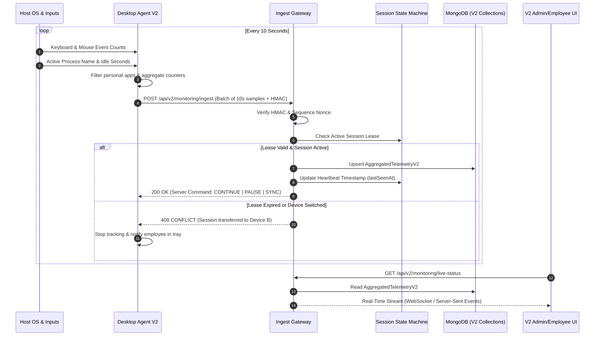
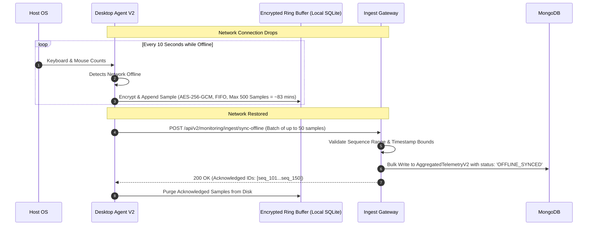

# Employee Monitoring V2: System Architecture & Data Flow Specification

**Document ID:** `ARCH-MONV2-003`  
**Classification:** System Architecture Document (SAD)  
**Date:** November 2026  
**Status:** COMPLETE  
**Scope:** Architecture Specification for Niyantran Employee Monitoring V2  

---

## 1. Architectural Principles & Design Goals

Employee Monitoring V2 is architectured from first principles to resolve the severe flaws of V1 (false idle attribution, invasive text capture, lack of device boundaries, and monolithic UI coupling).

### Core Architectural Pillars:
1. **Server-Authoritative State:** The desktop agent and browser are client nodes. Only the backend state machine determines session validity, device authorization, and productivity classification.
2. **Privacy-by-Design & Data Minimization:** Zero keystroke reconstruction, zero full-screen captures, zero private URL harvesting. Only aggregated input counts and whitelisted application categories are tracked.
3. **Decoupled Standalone UI:** The V2 frontend is a completely separate module (`Employee Monitoring V2`) with dedicated routes, hooks, components, and state management, preserving the legacy UI untouched.
4. **Resilient & Offline-First:** Network interruptions, system sleeps, and laptop transit are buffered locally in an encrypted queue and synchronized idempotently via batch sequence nonces.
5. **Strict Device Differentiation:** The system cleanly separates Phone (mobile attendance/workflows), Laptop/PC (verified agent monitoring), and Switch Device (secure session handoff).

---

## 2. High-Level System Architecture

```mermaid
flowchart TD
    subgraph Client Tier [Client & Agent Tier]
        Phone[A. Employee Mobile Device\nPWA / Mobile Browser]
        Desktop[B. Employee Workstation\nNiyantran Desktop Agent V2]
        WebClient[C. Employee & Admin Web UI\nReact SPA - Monitoring V2 Module]
    end

    subgraph Gateway Tier [Edge & Security Gateway]
        IngestGW[V2 Ingestion Gateway\nRate Limiter & HMAC Validator]
        AuthBoundary[Device Auth & Session Guard\nToken Lease Verifier]
    end

    subgraph Service Tier [Backend Services & State Engines]
        DeviceMgr[Device Management Service\nDevice Pairing & Lease Enforcement]
        SessionSM[Session State Machine\nACTIVE | FOCUSED | IDLE | AWAY | PAUSED]
        TelemetryAgg[Telemetry Normalizer & Aggregator\nWindow Slicing & Metric Rollup]
        AuditEngine[Tamper-Proof Audit Logger\nCryptographic Hash Chaining]
    end

    subgraph Storage Tier [Persistence Tier - MongoDB]
        M1[(RegisteredDevices)]
        M2[(MonitoringSessionsV2)]
        M3[(AggregatedTelemetryV2)]
        M4[(DeviceAuditLogs)]
    end

    subgraph Ecosystem Tier [Existing Niyantran System - Read-Only Contracts]
        AttModule[Attendance / DailyAttendance]
        TaskModule[Tasks & TaskSubmissions]
        AimModule[Aims & Progress]
        Parikshak[Parikshak Review Engine]
    end

    Phone -->|Mobile Check-In / Non-Monitored| AuthBoundary
    Desktop -->|Encrypted Telemetry Batch / 10s| IngestGW
    WebClient -->|Admin & Employee Queries| AuthBoundary
    
    IngestGW --> AuthBoundary
    AuthBoundary --> DeviceMgr
    AuthBoundary --> SessionSM
    
    SessionSM --> TelemetryAgg
    DeviceMgr --> AuditEngine
    
    DeviceMgr <--> M1
    SessionSM <--> M2
    TelemetryAgg <--> M3
    AuditEngine --> M4

    SessionSM -.->|Read Active Workday| AttModule
    TelemetryAgg -.->|Attribute Work to Task| TaskModule
    TelemetryAgg -.->|Correlate Daily Aims| AimModule
    TelemetryAgg -.->|Quality Evidence| Parikshak
```

---

## 3. Tier Responsibilities & Boundaries

### A. The Agent Tier (Desktop Agent V2)
- Runs as an independent, lightweight OS background service with an optional system tray UI.
- Hooks OS input events:
  - Aggregates raw keyboard keydown events into a simple counter (`keyPressCount`).
  - Aggregates mouse cursor movements, clicks, and scrolls into an activity score (`mouseActivityDelta`).
  - Queries OS hardware idle time via native power monitoring APIs.
  - Queries active foreground window via native Win32/Cocoa/X11 bindings; maps process executable to an allowlisted work category (`DEVELOPMENT`, `COMMUNICATION`, `DOCUMENTATION`, `NEUTRAL`, `EXCLUDED_PERSONAL`).
- Discards all private window titles and personal application names locally before transmission.
- Queues telemetry in local encrypted storage (`AES-256-GCM`) during network dropouts.
- Transmits batched telemetry every 10 seconds to `POST /api/v2/monitoring/ingest`.

### B. Ingestion Gateway Tier (`/api/v2/monitoring/ingest`)
- Enforces strict rate limiting (maximum 12 requests/minute per device).
- Validates the request signature using the device's shared HMAC key (`X-Device-Signature`).
- Rejects replayed requests using monotonic sequence numbers (`sequenceNumber`) and client timestamps (`X-Client-Timestamp`).
- Checks active session lease with `SessionStateManager`.

### C. Backend State Machine & Telemetry Engine
- **Session State Machine:** Maintains single-device authoritative leases. States:
  - `INITIALIZING`: Pairing or authenticating.
  - `ACTIVE`: Work session in progress on verified desktop; telemetry flowing.
  - `FOCUSED_WORK`: Low input rate but work application active (reading documentation, debugging, code review).
  - `IDLE`: No input events and hardware idle > configurable threshold (default 5 min).
  - `AWAY`: OS locked, screensaver active, or user stepped away.
  - `PAUSED`: Employee explicitly paused monitoring via UI.
  - `DISCONNECTED`: Heartbeat missed for > 90 seconds.
  - `COMPLETED`: Work session ended.
- **Telemetry Normalizer:** Consolidates raw 10-second agent samples into 1-minute rollup buckets. Computes balanced productivity metrics based on task alignment rather than raw key mashing.
- **Audit Logger:** Emits immutable security logs for all device pairing, session switching, pause/resume actions, and authorization failures.

### D. Persistence Tier (MongoDB)
- Fully decoupled collections with strict JSON schema validators and automated TTL retention indexes:
  - `registered_devices`: Device identity, public key/secret hash, OS metadata, approval status.
  - `monitoring_sessions_v2`: Active and historical work sessions, device leases, handoff logs.
  - `aggregated_telemetry_v2`: 1-minute rolled-up activity summaries (no raw text, no screenshots).
  - `device_audit_logs`: Audit trail for compliance and security events.

---

## 4. End-to-End Online & Offline Telemetry Pipelines

### A. Online Pipeline (Normal Operation)


### B. Offline Pipeline (Transit / Network Failure)


---

## 5. Telemetry Deduplication, Clock Skew & Conflict Resolution

1. **Monotonic Sequence Nonces:** Each agent instance increments a local 64-bit counter for every sample generated (`seq_1`, `seq_2`, ...). The server records the `lastProcessedSeq`. Duplicate or out-of-order deliveries caused by network retries are dropped idempotently.
2. **Clock Skew Compensation:** Client machines frequently suffer from unsynchronized system clocks. 
   - Every ingest handshake measures the delta: `clockSkewMs = serverTime - clientTimestamp`.
   - If `|clockSkewMs| > 120,000` (2 minutes), the request is rejected with `400 BAD_CLOCK_SKEW`, instructing the agent to resynchronize with NTP.
   - For valid skew (`< 120s`), the server normalizes the sample timestamps to the server's UTC timeline.
3. **Multi-Device Conflict Resolution:**
   - A user can have only **one** authoritative monitored work session at any given millisecond.
   - If Device A is actively streaming telemetry and Device B attempts to stream without a formal session switch, Device B is rejected with `409 ACTIVE_SESSION_ON_OTHER_DEVICE`.
   - Telemetry from unverified browser tabs is completely ignored in V2; only registered desktop agents can push OS-level telemetry.

---

## 6. Integration Contracts with Existing Niyantran Systems

Employee Monitoring V2 operates alongside existing Niyantran infrastructure through clean, read-only integration interfaces without mutating or breaking existing code:

| Existing System | Integration Mode | V2 Integration Interface & Behavior |
| :--- | :--- | :--- |
| **Attendance (`Attendance.js`)** | Read-Only Dependency | V2 checks `Attendance.findOne({ user: userId, endDayTime: null })` before allowing a monitored work session to start. When an employee ends their day via V2, V2 calls the existing attendance service endpoint. |
| **Tasks (`Task.js`, `TaskSubmission.js`)** | Read-Only Cross-Reference | Desktop Agent allows the employee to select their active task from `GET /api/tasks/my-tasks`. Telemetry rollups include `taskId`, enabling managers to see total focused time per task. |
| **Daily Aims (`Aim.js`)** | Read-Only Correlation | Daily V2 summary dashboards correlate tracked focused hours against the employee's submitted daily aims. |
| **Parikshak Review Engine** | Downstream Consumer | Parikshak's AI review packet builders can query `/api/v2/monitoring/summary/:employeeId` to read verified focus hours and application categories as objective evidence. |
| **Legacy Monitoring (`/api/monitoring`)** | Strictly Isolated | V2 uses `/api/v2/monitoring/*`. Legacy routes remain untouched for backwards compatibility until formal deprecation. |
