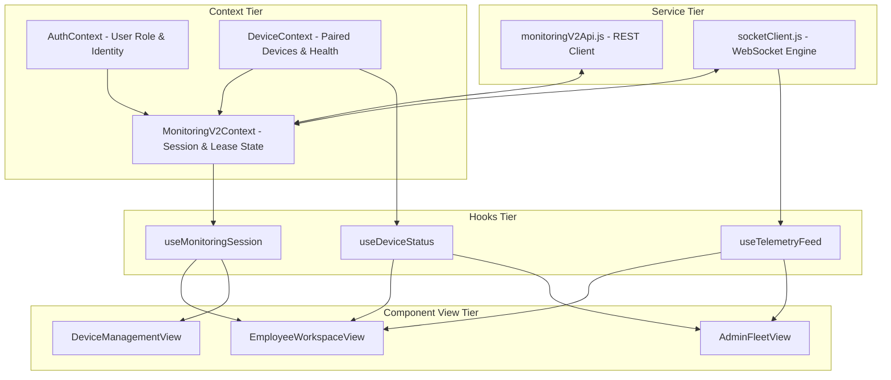

# Employee Monitoring V2: Standalone UI Blueprint & Component Architecture

**Document ID:** `UI-BLUEPRINT-006`  
**Classification:** Frontend Architecture & UI Design System Blueprint  
**Date:** November 2026  
**Status:** COMPLETE  
**Scope:** Standalone V2 Module Structure, Screen Specifications, Navigation & State Management  

---

## 1. UI Architecture & Isolation Guarantee

The Employee Monitoring V2 UI is engineered as an entirely **standalone, self-contained frontend module** within the Niyantran client application.

### Strict Isolation Rules:
1. **Zero Contamination of Legacy Code:** The existing route `/monitoring`, the legacy page `EmployeeMonitoring.jsx`, TRINETRA console (`TrinetraConsole.jsx`), and legacy monitoring components (`client/src/components/monitoring/*`) remain **100% untouched** during this upgrade.
2. **Dedicated Route Hierarchy:** All V2 routes are namespaced under `/monitoring-v2/*`.
3. **Dedicated Directory Root:** All V2 components, hooks, contexts, and API services live inside `client/src/modules/monitoring-v2/`.
4. **No Legacy Component Reuse:** V2 implements clean, accessible, modern UI components adhering to Niyantran's dark design tokens (`bg-slate-950`, `border-slate-800`, `text-slate-100`, `accent-indigo-500`).

---

## 2. Directory Structure & Module Layout

```
client/src/modules/monitoring-v2/
├── index.jsx                        # Module Entry & Sub-router
├── api/                             # Dedicated API Client
│   ├── monitoringV2Api.js           # REST calls to /api/v2/monitoring/*
│   ├── deviceApi.js                 # REST calls to /api/v2/devices/*
│   └── socketClient.js              # Real-time WebSocket subscriptions
├── context/                         # State Management
│   ├── MonitoringV2Context.jsx      # Global V2 Session & Device State
│   └── DeviceContext.jsx            # Active Device Pairing State
├── hooks/                           # Custom React Hooks
│   ├── useMonitoringSession.js      # Session lease, pause, resume, end controls
│   ├── useDeviceStatus.js           # Agent connectivity, battery, sync health
│   ├── useTelemetryFeed.js          # Live aggregated telemetry timeline stream
│   └── useDeviceHandoff.js          # Switch Device pairing and handoff flow
├── components/                      # Modular UI Components
│   ├── common/                      # Reusable V2 UI Elements
│   │   ├── DeviceBadge.jsx          # Phone / Laptop / Tablet mode indicator
│   │   ├── StatusPill.jsx           # Active / Focused / Idle / Paused / Offline
│   │   ├── PrivacyShieldNotice.jsx  # Prominent BYOD data protection disclaimer
│   │   └── MetricCard.jsx           # Stat display with sparkline & delta
│   ├── employee/                    # Employee-Facing Views
│   │   ├── EmployeeSessionHero.jsx  # Active session timer, controls, current task
│   │   ├── DeviceModeSelector.jsx   # Interactive Phone / Laptop / Switch cards
│   │   ├── AgentHealthWidget.jsx    # Desktop agent status, version, sync buffer
│   │   ├── TodayActivityTimeline.jsx# 1-minute bucket focus chart (no raw text)
│   │   └── PrivacyTransparencyModal.jsx # Shows employee exactly what data is recorded
│   ├── admin/                       # Admin / Manager Fleet Views
│   │   ├── FleetOverviewGrid.jsx    # Real-time team presence & device matrix
│   │   ├── DeviceInventoryTable.jsx # Registered devices, OS, agent version, last ping
│   │   ├── EmployeeFocusTimeline.jsx# Categorized focus breakdown (Dev, Docs, Review)
│   │   ├── DeviceAuditLogViewer.jsx # Immutable security audit trail
│   │   └── FleetAlertsPanel.jsx     # Connection drops, clock skew, duplicate alerts
│   └── modals/                      # Workflow Dialogs
│       ├── RegisterDeviceModal.jsx  # QR code & PIN pairing flow for desktop agent
│       ├── SwitchDeviceModal.jsx    # 3-step session handoff wizard
│       └── PauseBreakDialog.jsx     # Reason selection & timer for paused breaks
└── pages/                           # Top-Level Screen Containers
    ├── EmployeeMonitoringV2Page.jsx # Unified landing page (role-routed)
    ├── EmployeeWorkspaceView.jsx    # Employee self-management view
    ├── AdminFleetView.jsx           # Manager team dashboard
    └── DeviceManagementView.jsx     # Device registry & security settings
```

---

## 3. Route Map & Navigation Architecture

### A. Sidebar Navigation Integration
In `client/src/components/dashboard/sidebar.jsx`, a new dedicated navigation item is added alongside the legacy links without removing or altering the old `/monitoring` route:

```javascript
// Admin / Manager Navigation Section: "Employee Management"
{
  title: "Employee Monitoring V2",
  href: "/monitoring-v2",
  icon: ShieldCheck,       // Lucide icon indicating privacy & security
  badge: "V2 New",
  roles: ["Admin", "Manager", "Employee", "User"]
}
```

### B. Client Route Map
| Route Path | Role Access | Primary Component | Purpose |
| :--- | :--- | :--- | :--- |
| `/monitoring-v2` | All Authenticated | `<EmployeeMonitoringV2Page />` | Top-level dispatcher: renders Employee or Admin dashboard based on user role. |
| `/monitoring-v2/workspace` | Employee / All | `<EmployeeWorkspaceView />` | Employee self-monitoring: active session controls, mode selection, agent health, timeline. |
| `/monitoring-v2/devices` | All Authenticated | `<DeviceManagementView />` | Device pairing, registered computers list, switch device handoff. |
| `/monitoring-v2/fleet` | Admin, Manager | `<AdminFleetView />` | Real-time fleet health, team activity matrix, productivity rollups. |
| `/monitoring-v2/audit` | Admin | `<DeviceAuditLogViewer />` | Tamper-proof audit logs for device handoffs, pauses, and security events. |

---

## 4. UI Screen Specifications

### Screen 1: Employee Workspace View (`/monitoring-v2/workspace`)
```
┌────────────────────────────────────────────────────────────────────────────────────────────────────────┐
│  NIYANTRAN V2  │  Employee Monitoring V2  >  My Workspace                   [● Connected to Agent v2.0] │
├────────────────────────────────────────────────────────────────────────────────────────────────────────┤
│                                                                                                        │
│  ┌─ ACTIVE WORK SESSION ─────────────────────────────────────────────────────────────────────────────┐ │
│  │  Status: [● FOCUSED WORK]   Duration: 04h 12m   Active Task: #TK-841 (Frontend Architecture Audit)│ │
│  │  Current Mode: [🖥️ Laptop/PC - MacBook Pro (Verified Agent)]                                       │ │
│  │                                                                                                   │ │
│  │  [ ⏸️ Pause for Break ]    [ 🔄 Switch Device ]    [ 🛑 End Work Session ]                         │ │
│  └───────────────────────────────────────────────────────────────────────────────────────────────────┘ │
│                                                                                                        │
│  ┌─ DEVICE MODE SELECTION ───────────────────────────────────────────────────────────────────────────┐ │
│  │  ┌────────────────────────┐  ┌────────────────────────┐  ┌────────────────────────┐               │ │
│  │  │  📱 PHONE MODE         │  │  🖥️ LAPTOP / PC MODE   │  │  🔄 SWITCH DEVICE      │               │ │
│  │  │  Mobile Attendance     │  │  Verified Desktop Agent│  │  Seamless Session Move │               │ │
│  │  │  Task reviews & aims   │  │  OS Focus Tracking     │  │  Laptop <-> Phone      │               │ │
│  │  │  [ Switch to Mobile ]  │  │  [ Active (Current) ]  │  │  [ Initiate Handoff ]  │               │ │
│  │  └────────────────────────┘  └────────────────────────┘  └────────────────────────┘               │ │
│  └───────────────────────────────────────────────────────────────────────────────────────────────────┘ │
│                                                                                                        │
│  ┌─ TODAY'S ACTIVITY TIMELINE (Aggregated 1-Minute Buckets) ──────────────────────────────────────────┐ │
│  │  09:00       10:00       11:00       12:00       13:00       14:00       15:00       16:00       │ │
│  │  [██████████][████████░░][░░░░░░░░░░][██████████][██████████][████░░░░░░][══════════][██████████] │ │
│  │  ■ Development (65%)  ■ Documentation (20%)  ■ Communication (10%)  ░ Paused (5%)  ═ Offline      │ │
│  └───────────────────────────────────────────────────────────────────────────────────────────────────┘ │
│                                                                                                        │
│  ┌─ PRIVACY & DATA TRANSPARENCY SHIELD ──────────────────────────────────────────────────────────────┐ │
│  │  🛡️ BYOD Privacy Active: Keystroke text recording is permanently DISABLED. Screen captures are    │ │
│  │     DISABLED. Only aggregated input counts and whitelisted work applications are collected.        │ │
│  │     [ View Exactly What Is Stored ]     [ Configure Personal App Exclusions ]                     │ │
│  └───────────────────────────────────────────────────────────────────────────────────────────────────┘ │
└────────────────────────────────────────────────────────────────────────────────────────────────────────┘
```

### Screen 2: Admin / Manager Fleet Overview (`/monitoring-v2/fleet`)
```
┌────────────────────────────────────────────────────────────────────────────────────────────────────────┐
│  NIYANTRAN V2  │  Employee Monitoring V2  >  Team Fleet Dashboard           [Auto-refresh: 10s ● LIVE]  │
├────────────────────────────────────────────────────────────────────────────────────────────────────────┤
│  [Total Employees: 48]   [Active on PC: 32]   [Active on Mobile: 8]   [Paused: 4]   [Offline: 4]       │
├────────────────────────────────────────────────────────────────────────────────────────────────────────┤
│  🔍 Search employee or department...     [ Filter: All Branches ▾ ]    [ Device: All Modes ▾ ]         │
├────────────────────────────────────────────────────────────────────────────────────────────────────────┤
│  Employee Name      Mode         Device Info          Current Task / Category      Active Time  Health │
├────────────────────────────────────────────────────────────────────────────────────────────────────────┤
│  Rohan Sharma       🖥️ Laptop    MacBook Pro (macOS)  #TK-841 / Development (VS Code) 05h 14m    ● 100% │
│  Priya Patel        🖥️ PC        Dell XPS (Win 11)    #TK-820 / Documentation (Notion)04h 45m    ● 98%  │
│  Vikram Malhotra    📱 Phone     iPhone 15 (iOS PWA)  Mobile Review / Aims Verified   03h 10m    ● N/A  │
│  Ananya Sen         🖥️ Laptop    ThinkPad (Ubuntu)    #TK-890 / Code Review (GitHub)  06h 02m    ● 100% │
│  Aarav Mehta        ⏸️ Paused    MacBook Air (macOS)  Lunch Break (Resumes in 15m)    03h 40m    ● 95%  │
│  Kavita Rao         ⚠️ Offline   Dell Optiplex (Win)  Heartbeat Lost (Disconnected)   02h 15m    ○ Stale│
├────────────────────────────────────────────────────────────────────────────────────────────────────────┤
│  [ Export Fleet Report (CSV/PDF) ]              [ Manage Whitelist Policies ]   [ View Audit Trail ]   │
└────────────────────────────────────────────────────────────────────────────────────────────────────────┘
```

### Screen 3: Device Switch & Handoff Modal (`SwitchDeviceModal.jsx`)
```
┌──────────────────────────────────────────────────────────────────┐
│  🔄 Switch Active Work Session                                [✕]│
├──────────────────────────────────────────────────────────────────┤
│  Transfer your active work session from:                         │
│  CURRENT:  🖥️ Office Workstation (Windows 11)                   │
│                                                                  │
│  Step 1: Choose Destination Device                               │
│  ( ) 📱 Switch to Mobile (Phone Mode - Attendance preserved)     │
│  (•) 💻 Switch to Another Computer (Home Laptop / Mac)           │
│                                                                  │
│  Step 2: Authenticate Destination Device                         │
│  Open Niyantran Desktop Agent on your target computer, or scan   │
│  this secure pairing QR code:                                    │
│                                                                  │
│                     ┌─────────────────┐                          │
│                     │  [QR CODE HERE] │                          │
│                     │  Session Handoff│                          │
│                     │   PIN: 849-204  │                          │
│                     └─────────────────┘                          │
│                                                                  │
│  ⚠️ Mutual Exclusion: Once confirmed, Office Workstation will   │
│     halt monitoring immediately. Zero work history is lost.      │
│                                                                  │
│  [ Cancel ]                                 [ Confirm Handoff ]  │
└──────────────────────────────────────────────────────────────────┘
```

---

## 5. UI State Management Architecture



### Context State Contract (`MonitoringV2Context`):
```typescript
interface MonitoringV2State {
  isSessionActive: boolean;
  sessionId: string | null;
  sessionState: 'ACTIVE' | 'FOCUSED_WORK' | 'IDLE' | 'AWAY' | 'PAUSED' | 'DISCONNECTED';
  currentMode: 'PHONE' | 'LAPTOP_PC' | 'SWITCHING';
  activeDeviceId: string | null;
  activeTask: { id: string; title: string } | null;
  leaseExpiresAt: string | null;
  bufferedSamplesCount: number;
  pauseRemainingSeconds: number;
  privacyMode: 'BYOD_STRICT';
  timelineBuckets: Array<{
    minuteTimestamp: string;
    category: 'DEVELOPMENT' | 'DOCUMENTATION' | 'COMMUNICATION' | 'NEUTRAL' | 'PAUSED';
    focusScore: number;
    keyCount: number;
    mouseDelta: number;
  }>;
}
```

---

## 6. Accessibility & Visual Standards
- **Color Contrast:** All text elements adhere to WCAG 2.1 AA standards (minimum 4.5:1 contrast against dark background).
- **Status Consistency:** 
  - Green (`emerald-500`): Active Monitored Work / Agent Online.
  - Blue (`indigo-500`): Focused Work (Low input, reading/debugging).
  - Amber (`amber-500`): Paused Break / Temporary Network Disconnect.
  - Slate (`slate-500`): Mobile Workflow / Non-Monitored Phone Mode.
  - Red (`rose-500`): Stale / Duplicate Collision Detected.
- **Responsive Layout:** Complete responsiveness down to 360px viewport width for mobile device workflows, scaling seamlessly to 4K multi-monitor manager dashboards.
